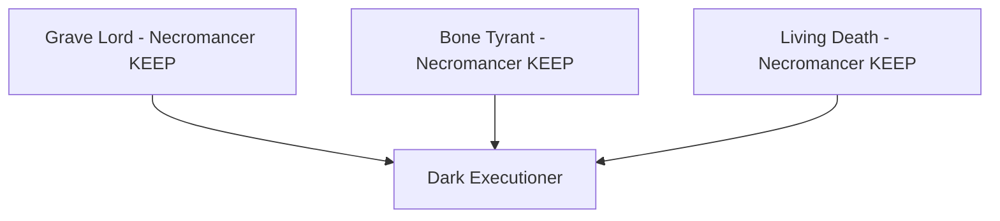
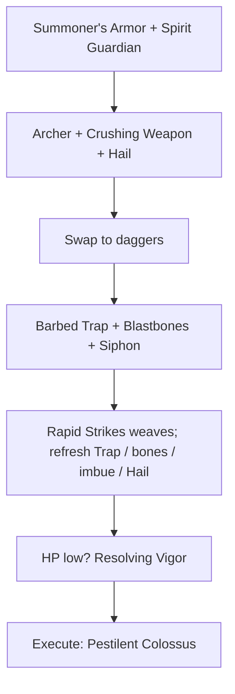

# Build Plan - Heka-Ankh: Dark Executioner (Peak Necromancer)

> **Character profile:** [heka_ankh.md](heka_ankh.md) — Level 50 Female Redguard Necromancer, CP 1117, @SOLAEGIS (NA). Pronouns: **she/her**.

Heka-Ankh is an exile of the Alik'r who treats necromancy as law, not heresy. She **KEEP**s all three native lines — **Grave Lord**, **Bone Tyrant**, and **Living Death** — because this is a **Peak Necromancer**, not an Uber hybrid. No Dark Deal, no Hurricane, no foreign class pillar. Class Mastery stays on.

The locked kit is **Psijic Peak**: **Crushing Weapon** is the Major Breach (not Camouflaged Hunter, not Night Mother's Gaze). Dual Wield daggers are front; Bow is back. Live she is still on a 2H / Bow bridge with Time Stop and Witchmother's Brew. The rewrite is bars, food, potions, CP, and a craftable 5+5 — not a Bahtra respec.

---

## Build at a glance

| **Attribute** | **Recommendation** |
| :--- | :--- |
| **Gender / Pronouns** | **Female** (from profile) — **she/her** |
| **Alignment** | **Lawful Neutral** — Dark Executioner — Tu'whacca's clock by steel; exile who still sentences the living |
| **Primary Stat** | 64 points in **Stamina** — **live:** 0 / 0 / 64 (Witchmother's: 18,892 Health · 19,368 Magicka · 24,695 Stamina · Weapon Power 2,873 · crit 25.3% · pen 350 · crit dmg 64%) · **target:** 64 Stamina on **Garlic Cod with Potato Crust** |
| **Mundus Stone** | **The Thief** (+1,212 crit; +1,982 with 7× Divines) — **live:** The Thief. Do not take The Warrior for damage (hybrid +238 / +389 WD+SD). The Apprentice is XP only |
| **Vampirism** | **Never** — profile Never, not Cured. Do not infect for Curative Curse |
| **Lycanthropy** | **Never** — mutually exclusive with active vampirism; she has neither |
| **Trinity** | **Grave Lord** + **Bone Tyrant** + **Living Death** KEEP — **live:** same, subclass none · **decision:** Peak / true necromancer; completing Bahtra is optional and must not swap lines |
| **Sets** | **5 Order's Wrath + 5 Hunding's Rage** (100% craftable) — **live:** Hawk's Eye 3 / Briarheart 2 / NMG 1 shoulder / Trainee bow / Fine frost 2H · **target:** 7 Order's body + Hunding jewelry and both weapon bars |
| **Bars** | Front: Dual Wield daggers ("The Executioner's Daggers") · Back: Bow ("The Executioner's Sight") — **live:** 2H + Bow bridge |
| **Food** | **Garlic Cod with Potato Crust** — +5,395 Health / +4,936 Stamina / 60 min (verified). Live Witchmother's is a Magicka drink on a stamina bar. **Bewitched Sugar Skulls** only if world-boss dodge fails |
| **Potion** | **Essence of Health** once Archer + Siphon are up (draft: Major Fortitude; no restore amounts). **Essence of Heroism** only as a bridge while those skills are down. Never Essence of Weapon/Spell Power |
| **Weapon Poisons** | Optional Damage Health on the daggers; not required |
| **Staff/Weapon Enchant** | Front: **Poison** MH / **Poison** or **Flame** OH · Back: **Glyph of Crushing** (Infused) |
| **Companion** | **Primary (now):** **Mirri Elendis** (healer) at live CP **1117** + companion **15/20** · **Secondary:** **Zerith-var** · **Goal (20/20 @ CP160):** **Isobel Veloise** |
| **Primary Mount** | **Dwarven War Horse** (owned) · **Ideal:** **Dune Stalker Senche** (unowned) — see [Collectibles](#collectibles) |
| **Flavor Pet** | **Alik'r Dune-Hound** (owned) · **Ideal:** **Alik'r Dune-Hound** — see [Collectibles](#collectibles) |
| **Costume** | **Forebear Dishdasha** (owned) · **Alt:** **Grim Harvester** — see [Collectibles](#collectibles) |

**Read next:** [Roleplay](#roleplay-dark-executioner) · [Trinity configuration](#trinity-configuration) · [Combat kit](#combat-kit-the-executioners-clock) · [Gear and crafting](#gear-and-crafting-orders-and-hunding) · [Champion points](#champion-point-mapping-cp-1117) · [Companion](#companion-strategy-the-executioners-retinue) · [Collectibles](#collectibles) · [Checklist](#next-steps--in-game-action-checklist)

---

## Roleplay: Dark Executioner

The profile title is already **Dark Executioner**. Heka-Ankh left the Alik'r with the Forebear silhouette still on her shoulders and Tu'whacca's law still in her mouth. She does not hide from death. She clocks it. Bones, corpses, and the Psijic imbue are the same sentence written three ways: the guilty are marked, the hour is called, the body is spent.

She keeps every native necromancer line because the exile's argument is that necromancy *is* the discipline. A borrowed Storm or Dark Magic pillar would make her someone else's executioner. Crushing Weapon is the time-mark — not a vampire sneak, not a wolf's pack hunt.

> [!TIP]
> **Suggested Custom Title:** `Dark Executioner of the Alik'r Sands`

> [!NOTE]
> **Build Notes (paste into LAM Custom Title / Build Notes):**
> Heka-Ankh keeps the sentence and the clock. She is a Redguard necromancer of the Alik'r: Grave Lord, Bone Tyrant, and Living Death stay hers — no foreign class line. Dual Wield daggers front, bow back. Crushing Weapon is the mark of time (Major Breach), then the bones. 64 Stamina. The Thief. Never vampire, never wolf. Food: Garlic Cod with Potato Crust. Potion: Essence of Health once Archer and Siphon are up. Gear: seven Order's Wrath body, Hunding's Rage on jewelry and both weapon bars, crafted by @masisi. Companion: Mirri heals today; Zerith when the dead need a priest; Isobel when the sentence must look like a knight. Mount: Dwarven War Horse (Favorites rotate). Pet: Alik'r Dune-Hound. Costume: Forebear Dishdasha.

> [!TIP]
> **Flavor Pet:** **Alik'r Dune-Hound** — desert hound at the executioner's heel. **Ideal (any source):** **Alik'r Dune-Hound**. See [Collectibles](#collectibles).

> [!TIP]
> **Costume:** **Forebear Dishdasha** — Alik'r civilian law, not a cult robe. **Alt:** **Grim Harvester**. Full picks under [Collectibles](#collectibles).

---

## Trinity configuration

### Subclassing decision (required)

Subclass unlocks at **Level 50** via Bahtra at-Hunding (**"A Study in Discipline"**). Unlocking the quest makes subclassing *available* — it does **not** mean she must swap lines. See [docs/subclassing.md](../../../docs/subclassing.md).

**This build's decision:** **KEEP all three native lines.** Peak / true necromancer. Dark Deal / Hurricane would parse higher on paper and would stop being a necromancer. Live export is already Grave Lord / Bone Tyrant / Living Death with subclass none. Completing Bahtra later is optional; **do not swap lines**.

| **Pillar** | **Line** | **Origin** | **Slot action** | **Function** |
| :--- | :--- | :--- | :--- | :--- |
| **Weapon** | **Grave Lord** | Necromancer (native) | **KEEP** | **Blighted Blastbones** (Major Defile), **Skeletal Archer** (Major Brutality), **Detonating Siphon** (Major Savagery + 3% damage while slotted), **Pestilent Colossus** (Major Vulnerability). **Dismember** +3,271 pen while a Grave Lord ability is *active* |
| **Fortress** | **Bone Tyrant** | Necromancer (native) | **KEEP** | **Summoner's Armor** (Bone Armor morph): Major + Minor Resolve (+5,948 / +2,974). One Bone Tyrant slotted also feeds **Health Avarice** (+3% healing taken). Not Bone Goliath as the main ult |
| **Death** | **Living Death** | Necromancer (native) | **KEEP** | **Spirit Guardian** (Spirit Mender morph) — Living Death slot and corpse economy. `skills.json` models no mitigation percent; keep the morph anyway. **Near-Death Experience** is healing-ability crit vs wounded, not a +12% damage-crit |

> [!IMPORTANT]
> **Do not subclass by default.** Only replace a native line later if a foreign line clearly outperforms it on the same content with craftable gear already correct. This plan forbids that swap.

---

## Combat kit: The Executioner's Clock

Open on the bow: Armor, Archer, Crushing Weapon, Hail. Swap to the daggers: Trap, Blastbones, Siphon, Rapid Strikes. Melee is front; bow is back. Spirit Guardian and Skeletal Archer are **not** Daedric summons — one bar each is legal. One corpse spender: **Detonating Siphon** (unslot Avid Boneyard).

### Skill bars

Document **slotted morph names as shown in the skills UI**. Each morph appears at most once. Bars match the target weapons (daggers front, bow back).

#### Front Bar (Dual Wield): "The Executioner's Daggers"

| **Slot** | **Class/Line** | **Base → Morph** | **Role** | **Profile** |
| :--- | :--- | :--- | :--- | :--- |
| **1** | Dual Wield | Flurry → **Rapid Strikes** | Stamina spammable (2,430) | Respec (live Dizzying Swing) |
| **2** | Grave Lord | Sacrificial Bones → **Blighted Blastbones** | Corpse + Major Defile (1,836 stam) | Live |
| **3** | Fighters Guild | Trap Beast → **Barbed Trap** | Minor Force (+10% crit damage); 3,240 stam | Respec (live Rally) — do not leave Trap on the back bar |
| **4** | Grave Lord | Shocking Siphon → **Detonating Siphon** | Corpse spend; Major Savagery; **+3% damage done while slotted** (0 cost) | Respec (live Executioner) |
| **5** | Assault | Vigor → **Resolving Vigor** | Burst heal (2,984 stam). Minor Resolve overlaps Summoner's Armor — keep for the heal | Live |
| **6 (Ult)** | Grave Lord | Frozen Colossus → **Pestilent Colossus** | 150 Ultimate; Major Vulnerability | Respec (live Frozen Colossus) |

#### Back Bar (Bow): "The Executioner's Sight"

| **Slot** | **Class/Line** | **Base → Morph** | **Role** | **Profile** |
| :--- | :--- | :--- | :--- | :--- |
| **1** | Bow | Volley → **Endless Hail** | AoE Physical DoT (2,700 stam) | Live |
| **2** | Psijic Order | Imbue Weapon → **Crushing Weapon** | Major Breach (−5,948); 2,700 stam | Respec (live Time Stop — **unslot**; 7,830 mag) |
| **3** | Grave Lord | Skeletal Mage → **Skeletal Archer** | Major Brutality (2,525 stam) | Live — **do not drop** for Trap or Hunter |
| **4** | Bone Tyrant | Bone Armor → **Summoner's Armor** | Major + Minor Resolve (2,700 mag) | Respec (live second Vigor) |
| **5** | Living Death | Spirit Mender → **Spirit Guardian** | Living Death slot + corpse (4,320 mag) | Respec |
| **6 (Ult)** | Fighters Guild | Dawnbreaker → **Flawless Dawnbreaker** | Back ult; FG rank 10 | Respec (live duplicate Frozen Colossus) |

**Whirling Blades** is a later trash/execute flex, not a buff pillar. Do not put it on the target front bar — that slot is **Barbed Trap** so Archer can stay on the back bar (Major Brutality).

**Phase 0 bridge** (skills she has; 2H front until placeholder daggers): Dizzying Swing / Blastbones / Rally / Executioner / Vigor / Frozen→Pestilent · Hail / Archer / **unslot Time Stop** / Trap when bought / Crushing Weapon at Psijic 3. Rally covers Brutality until Archer is recast on the target back bar.

### Rotation and combat tips

#### Solo combat tips

1. **Breach is the imbue.** Crushing Weapon is the only Major Breach on this kit. Refresh it each window (2,700 stam). Night Mother's Gaze 5pc is worth **0** while it is up. `skills.json` models Major Breach only — do not quote an extra weapon-attack percent.
2. **Archer stays.** Skeletal Archer is the verified Major Brutality source. Rally is 2H-only. Essence of Heroism is a **draft** potion — do not make the peak kit depend on it.
3. **Siphon is the Savagery and the +3%.** Detonating Siphon is also the only main-bar corpse spender. Do not also slot Avid Boneyard.
4. **Keep a Grave Lord ability active** so **Dismember** (+3,271 pen) stays on. Archer, Siphon (20s), Blastbones, and Colossus all count.
5. **Do not sneak-open on Crushing Weapon.** The UESP page says the imbue cannot conceal; the support table does not model that line. Treat it as a loud mark.
6. **Bank leftover skill points.** Do not buy **Reach**. **Continuous Attack** waits on Alliance rank (Assault is live only as Vigor). Eldritch Insight: leave **10** (refund the extra 7).

### Passive skills

**49 skill points** available. Spend in this order; fully rank where noted. Quote only `verified: true` numbers. Draft passives: buy the class ones, quote the raw tooltip, mark unverified.

#### Necromancer — Grave Lord

* **Dismember (II):** live. +3,271 offensive pen while a Grave Lord ability is active.
* **Rapid Rot (0/2 → II):** +10% DoT (Hail, Siphon, Blastbones, Trap, Colossus).
* **Reusable Parts (II), Death Knell (II):** live. Draft rows — Reusable Parts: next Bones / Mage / Mender costs 66% less when one dies. Death Knell: +20% crit vs enemies under 33% Health (unverified parse; quote the tooltip).

#### Necromancer — Bone Tyrant

* **Last Gasp (II):** +2,412 Max Health.
* **Health Avarice (II):** +3% healing taken per Bone Tyrant ability slotted (one slotted = +3%).
* **Death Gleaning (II):** +666 Magicka and Stamina on kill while a Bone Tyrant ability is slotted and you are in combat.
* **Disdain Harm (II):** draft — "Reduce the damage you take from damage over time abilities by 15% while you have a Bone Tyrant ability active."

#### Necromancer — Living Death

* **Near-Death Experience (II):** healing-ability Critical Chance up to 12% vs wounded (raw tooltip). **Not** +12% weapon/spell crit.
* **Corpse Consumption (II):** +10 Ultimate on consume corpse.
* **Curative Curse (II):** draft — +12% healing done while you have a negative effect. Do not take vampire to proc it.
* **Undead Confederate (II):** draft — +155 Health/Magicka/Stamina while Bones, Mage, or Mender is active.

#### Weapon — Dual Wield / Bow

* Dual Wield rank 38. Buy **Focused Killer**, **Ambidextrous**, **Controlled Fury** (−15% Dual Wield ability cost), **Ruffian** (draft: +15% vs stunned/immobilized/silenced) as ranks allow.
* **Twin Blade and Blunt** waits on Dual Wield 41: daggers +657 Weapon and Spell Critical each condition.
* Bow: **Vinedusk Training**, **Accuracy** (+1,314 crit on bow), **Ranger** (−15% Bow ability cost) live. Finish **Hawk Eye (1/2 → II)** (+5% damage per stack on light/heavy, max 5). **Hasty Retreat (II)** later (Major Expedition on dodge).

#### Armor — Medium (6) + Heavy head (1)

* Medium passives live maxed: **Wind Walker** +4% Max Stamina and −2% stamina-ability cost per medium (6 pieces → +24% / −12%); **Agility** +2% WD/SD per medium (+12%).
* Do not dump points into unused Light or 5-piece Heavy lines.

#### Guild — Fighters Guild / Psijic / Alchemy

* FG 9: **Slayer (III)** live. Finish **Banish the Wicked (2/3)**. **Flawless Dawnbreaker** at rank 10.
* Psijic 2: **See the Unseen** live. Rank 2→3, buy **Imbue Weapon → Crushing Weapon**. Later **Clairvoyance (II)** −15% Psijic cost. Spell Orb / Concentrated Barrier are drafts — optional after the imbue.
* **Medicinal Use (0/3 → III):** +30% potion duration.

#### Race — Redguard

* **Martial Training (III), Conditioning (III)** (+2,000 Max Stamina), **Adrenaline Rush (III)** (+1,005 Stamina on damage) live.
* **Wayfarer:** draft — +15 minutes food duration. Already unlocked; do not treat the extra duration as a verified number.

#### Alliance — Assault

* **Resolving Vigor** is slotted. Take **Continuous Attack** when Alliance rank allows (draft: Gallop always; 10% WD/SD after capturing an objective). Do not spend filler on **Reach**.

---

## Gear and crafting: Order's and Hunding

100% craftable. A bow counts as **2** set pieces on the active bar (`caps.json`, verified). Armor and jewelry count on both bars; weapons do not. Correct 5+5 is **7 Order's Wrath body** + **Hunding jewelry + both weapon bars** — the same pattern @masisi already crafts for Karakedi. The old "4 Hunding armor + Hunding bow = 5" split is wrong on the front bar (no bow → 4 Hunding).

### Set rationale

| **Set** | **5-Piece Bonus** | **Role in the Build** |
| :--- | :--- | :--- |
| **Order's Wrath** | +943 Critical Chance and **+8% Critical Damage / Critical Healing** (2/4pc +657 crit; 3pc +129 WD/SD) | Crit-damage 5pc once Breach is a skill. Thief mundus feeds it |
| **Hunding's Rage** | +300 Weapon and Spell Damage (2/4pc +657 crit; 3pc +1,096 Stamina) | Always-on WD floor on jewelry and both bars |

> [!NOTE]
> **Why not Night Mother's Gaze?** Crushing Weapon already applies Major Breach (−5,948). NMG 5pc is the same debuff on crit — worth **0** while the imbue is up. `value_calc.py` at est. CP160 (`crit 48% · cd 88% · pen 1,500 · power 3,600 · stam 28,000`): dropping Order's 5pc is **−5.12%**; swapping Order's 5pc for NMG while Breach is already up is the same **−5.12%**. NMG only beats Order's if there is **no** skill Breach (**+4.61%** @0.85 / **+4.04%** @0.8) — that is the discarded Living Peak package.
>
> **Why 1 heavy head?** Live Health is 18,892. One heavy Divines head keeps six medium pieces (Wind Walker / Agility math above) without going full heavy.

**Buff ledger (solo; do not double-count):**

- Major Breach: Crushing Weapon.
- Major Brutality: Skeletal Archer.
- Major Savagery: Detonating Siphon.
- Major + Minor Resolve: Summoner's Armor. Essence of Immovability would overlap Major Resolve.
- Minor Force: Barbed Trap (10% crit damage).
- Caps (quote verified only): dummy resist **18,200**, crit-damage cap **125%**, bow/2H = **2** pieces, small-piece armor glyphs **40%** (868 vs 347 Stamina).

Pen vs 18,200 (honest shortfall): Breach 5,948 + Dismember 3,271 + Piercing 700 + Glyph of Crushing 1,622 + live sheet ~350 ≈ **11.9k**. Craftable-only; do not invent extra pen. Thief stays.

Crit damage vs 125: base 50 + Order's 8 + Fighting Finesse 8 + Minor Force 10 + Backstabber 10 (flank) = **86**. Room.

### Target loadout

| **Slot** | **Set** | **Weight** | **Trait** | **Enchantment** | **Quality** |
| :--- | :--- | :--- | :--- | :--- | :--- |
| **Head** | Order's Wrath | Heavy | Divines | Max Stamina (full 868) | Purple → Gold |
| **Shoulders** | Order's Wrath | Medium | Divines | Max Stamina (40% = 347) | Purple → Gold |
| **Chest** | Order's Wrath | Medium | Divines | Max Stamina (full 868) | Purple → Gold |
| **Hands** | Order's Wrath | Medium | Divines | Max Stamina (347) | Purple → Gold |
| **Waist** | Order's Wrath | Medium | Divines | Max Stamina (347) | Purple → Gold |
| **Legs** | Order's Wrath | Medium | Divines | Max Stamina (full 868) | Purple → Gold |
| **Feet** | Order's Wrath | Medium | Divines | Max Stamina (347) | Purple → Gold |
| **Neck** | Hunding's Rage | Jewelry | Bloodthirsty | Increase Physical Harm (174 WD) | Purple → Gold |
| **Ring 1** | Hunding's Rage | Jewelry | Bloodthirsty | Increase Physical Harm (174 WD) | Purple → Gold |
| **Ring 2** | Hunding's Rage | Jewelry | Bloodthirsty | Increase Physical Harm (174 WD) | Purple → Gold |
| **Front Main** | Hunding's Rage (Dagger) | 1H | Precise | Glyph of Poison (2,534) | Purple → Gold |
| **Front Off** | Hunding's Rage (Dagger) | 1H | Precise | Glyph of Poison or Flame (2,534) | Purple → Gold |
| **Back Weapon** | Hunding's Rage (Bow) | 2H | Infused | Glyph of Crushing (1,622; Infused +30%) | Purple → Gold |

**Front bar — Dual Wield:** Precise is +3.6% Weapon/Spell Critical per dagger (gold 1H). Bloodthirsty jewelry is up to +350 WD under 90% Health — value at roughly half.

**Back bar — Bow:** Two-hander = 2 Hunding pieces. Infused (+30% enchant, −50% cooldown) on Crushing is the pen glyph that carries after swap.

Interim: Night's Silence or leftover Hawk's Eye / Trainee only until Order's and Hunding mats land. Do not gold the Fine frost greatsword.

### Crafting handoff (@masisi)

| **Detail** | **Recommendation** |
| :--- | :--- |
| **Style** | Yokudan / Redguard / Forebear — Alik'r civilian law |
| **Set station** | Order's Wrath (High Isle, Steadfast Hammer and Saw — 3 traits) · Hunding's Rage (overland stations — 6 traits) |
| **Traits** | Divines (armor), Bloodthirsty (jewelry), Precise (both daggers), Infused (bow) |
| **Interim (pre-CP160)** | Placeholder Hunding / Order's purple; keep the Trainee bow until the Infused Hunding bow exists |
| **Quality path** | Purple all 12 + weapons → gold weapons first, then jewelry, then body |

> [!NOTE]
> **Research gate:** Coordinate with @masisi before gold CP160 work. He already crafts this pairing for Karakedi. See [`masisi.md`](masisi.md).

---

## Champion Point Mapping (CP 1117)

> [!NOTE]
> **Star catalog:** Exact names, max points, and slottable vs passive from [`champion_points_reference.md`](../../templates/champion_points_reference.md) (YAML: [`champion_points.yaml`](../../templates/champion_points.yaml)). **4** slotted stars per discipline at 900+ total CP. Walk `prerequisites` (ancestor minimums before children).

Full CP budget: **372 Warfare / 373 Craft / 372 Fitness** (1117 total). Live: **217 / 151 / 155** spent, **155 / 222 / 217** free.

### Warfare (Blue — 372 Points)

Live slotted: Master-at-Arms, Deadly Aim, Backstabber. **Add Fighting Finesse** (Precision 10 already unlocks it). Finish Precision 10→20 and Piercing 10→20. Eldritch Insight **17→10** (refund 7; Piercing and Quick Recovery need 10). Tireless Discipline is a Piercing ancestor in the YAML — spend it to 40 for +520 Max Stamina (verified). Then Battle Mastery 20 → Mighty.

| **Slotted Star** | **Spend** | **Benefit** |
| :--- | :--- | :--- |
| **Fighting Finesse** | 50 points | +8% Critical Damage and Critical Healing (verified) |
| **Master-at-Arms** | 50 points | +6% direct damage (verified; ignore the YAML 15% note) |
| **Deadly Aim** | 50 points | +6% single-target (verified) |
| **Backstabber** | 50 points | +10% crit damage vs flanked targets (verified) — keep live |

**Passives (no slot needed):**

* **Precision (10/20 → 20/20):** +320 Weapon/Spell Critical at max (verified)
* **Piercing (10/20 → 20/20):** +700 offensive pen at max (verified)
* **Eldritch Insight (17 → 10/20):** leave 10; refund 7. Do not dump to 0
* **Quick Recovery (10/20 → 20/20):** +2% healing taken (verified)
* **Preparation (20/20):** live. Draft tooltip: −5% damage taken from non-player attacks per stage
* **Tireless Discipline (0 → 40/40):** +520 Max Stamina (verified)
* **Battle Mastery (20/40) → Mighty (30/30):** martial status then +WD/SD to martial attacks — leftover Warfare after the stars above

### Fitness (Red — 372 Points)

Unslot **Siphoning Spells 17** (draft on-kill Magicka restore — wrong resource). Keep **Boundless Vitality 50** and **Rejuvenation 50** (do not quote the support-table Health parse). **Add Fortified** (+1,730 physical/spell resist, verified). Finish **Hasty 8→16** so **Celerity** unlocks (YAML: Hasty 10).

| **Slotted Star** | **Spend** | **Benefit** |
| :--- | :--- | :--- |
| **Boundless Vitality** | 50 points | +1,400 Max Health (verified) |
| **Fortified** | 50 points | +1,730 Physical and Spell Resistance (verified) |
| **Rejuvenation** | 50 points | Already slotted — recovery; no Health number from the table |
| **Celerity** | 50 points | +10% movement speed (verified) |

**Passives:**

* **Hero's Vigor (20/20):** live
* **Hasty (8/16 → 16/16):** Celerity ancestor
* **Sprinter (10/20):** live; finish if leftover
* **Tumbling (0 → 30/30):** dodge cost — live dodge is 2,524
* **Bloody Renewal** is the stamina on-kill analog of Siphoning and is also a **draft** — optional later, not a required fourth slot

### Craft (Green — 373 Points)

Live: Fortune's Favor 50, Gilded Fingers 50, Breakfall 1, Steed's Blessing 50. Walk ancestors before children. Combat-first path (food/potion), then gatherer/mount.

| **Slotted Star** | **Spend** | **Benefit** |
| :--- | :--- | :--- |
| **Steed's Blessing** | 50 points | Out-of-combat move speed — live |
| **Gifted Rider** | 50 points | After Master Gatherer 15 — mount speed |
| **Master Gatherer** | 15+ of 75 | Harvest time; ancestor of Gifted Rider / Plentiful Harvest |
| **War Mount** | 75 points | After Gifted Rider 10 + Plentiful Harvest 10 — last slotted when the tree is walked |

**Passives (walk in order):**

* **Wanderer (10)** ← Fortune's Favor 10 (have 50)
* **Steadfast Enchantment (10)** ← Wanderer 10
* **Rationer (30/30)** ← Steadfast 10 — +10 minutes food per stage (duration only)
* **Liquid Efficiency (50)** ← Rationer 10
* **Inspiration Boost (15)** ← Fortune's Favor 10 → **Meticulous Disassembly (50)**
* **Treasure Hunter (50)** ← Meticulous 50 + Steadfast 10
* Then Fade Away / Master Gatherer / **Plentiful Harvest (10)** / Gifted Rider / War Mount
* Do not buy filler Craft stars to spend the last points. No Reach anywhere

---

## Companion Strategy: The Executioner's Retinue

Companion gear is separate from player gear — companions equip **Companion's** weapons, armor, and jewelry with **companion-only traits** (Quickened, Aggressive, Bolstered). There are no player gear sets or 5-piece bonuses on companions.

> [!NOTE]
> **Live export:** **Mirri Elendis** — Level **15/20**, Companion's Restoration Staff (Epic, cooldown trait), mix of Fine / Superior light, bar **Rejuvenation / Ghostly Evasion / Masque of Torment / Twilight Mantle / Crimson Font / empty ult**. Character **Level 50 / CP 1117**. Companion gear has **no item level** — ignore `(Level 1)` / outdated-gear warnings. Judge **quality** and trait. Assign the ult.

### Companion picks

| **Tier** | **Companion** | **Role** | **Roleplay fit** | **Mechanical fit (at current stats)** |
| :--- | :--- | :--- | :--- | :--- |
| **Primary (now)** | **Mirri Elendis** | Healer | Antiquarian who will catalog the sentence | 15/20 resto already heals. Empty ult wastes the bar. Raise Fine pieces to Superior+ |
| **Secondary** | **Zerith-var** | Necromancer escort | Priest of the moon who understands the dead | Swap when the kit is all corpses and Mirri's commentary wears thin |
| **Goal (20/20 @ CP160)** | **Isobel Veloise** | Knight / shields | The sentence wearing a knight's face | Full 20/20 tank-heal. **Rapport:** she dislikes necromancy — dismiss before long corpse loops if her meter drops |

### Goal companion — Isobel Veloise: The Knight's Face

When Heka-Ankh is the clock, Isobel is the public law.

| **Setting** | **Recommendation** |
| :--- | :--- |
| **Role** | Shield / heal |
| **Gear Weight** | Heavy |
| **Gear Trait** | Bolstered / Quickened — companion-only |
| **Loadout** | Full **heavy** Companion's armor + **Companion's Sword and Shield** or resto if she stays healer — all companion-only (no player sets) |
| **Acquisition** | White basics from armorers; **Superior+** traited pieces from boss/overland drops while she is active. **Not** part of player [Gear and crafting](#gear-and-crafting-orders-and-hunding) |

#### Isobel's support skill bar (goal @ 20/20)

1. **Holy Ground:** Templar. Group heal / standing zone
2. **Sun Shield:** Templar. Damage shield
3. **Divine Protection:** emergency burst heal
4. **Biting Armor:** taunt / armor
5. **Fountain of Light:** sustain heal
6. *Ultimate:* **Light's Champion** — burn / emergency

### Primary now — Mirri Elendis

She is already out and already on resto. Finish **15→20**, fill the empty companion ultimate from her healer line, and replace Fine light with Superior+ **Quickened** / heal-done traits while she is summoned. Start leveling Isobel on easy overland; keep Zerith ready when Mirri is dismissed.

> [!TIP]
> **Secondary — Zerith-var:** Summon him for necromancer-friendly commentary and a second corpse kit. He is the RP fit; Isobel is the world-boss shield.

---

## Collectibles

### Mount

Overland she should look like a Forebear officer on a bronze machine-horse — Pact steel, Alik'r law. Do **not** pin one mount in-game; **ESO Favorite Collectibles** rotates the set below.

> [!NOTE]
> **Owned mounts (from profile):** 45 unlocked, including Dwarven War Horse, Ebon Dwarven Horse, Hammerfell Camel, Pyrodraconic Camel-Lizard, Rahd-m'Athra, Psijic Escort Charger.

#### Primary (owned): Dwarven War Horse

| **Attribute** | **Detail** |
| :--- | :--- |
| **Why** | Bronze clockwork on sand — the sentence rides a machine, not a carnival senche |
| **Acquisition** | Owned |
| **Dye pass** | Brass / charcoal / Alik'r tan |

#### Other owned options

| **Mount** | **Owned** | **Why** |
| :--- | :--- | :--- |
| **Hammerfell Camel** | ✅ | Alik'r civilian; backup desert read |
| **Ebon Dwarven Horse** | ✅ | Darker sibling of the primary |
| **Pyrodraconic Camel-Lizard** | ✅ | Owned S-tier; keep in Favorites, not the daily pin |

#### Avoid thematically

| **Mount type** | **Reason** |
| :--- | :--- |
| **Flame Atronach Senche / Nightmare Senche** | Other NA primaries; wrong silhouette for a Forebear executioner |
| **Generic stable horses** | Starter beige |

> [!TIP]
> **Ideal mount (any source):** **Dune Stalker Senche** — Alik'r cat on the sand. **Acquisition:** Crown Store / crates; unowned. Do not treat it as Primary.

#### Favorites (ESO Favorite Collectibles / Collections)

| **Favorite mounts** | **Why in the set** |
| :--- | :--- |
| **Dwarven War Horse** | Primary overland silhouette |
| **Hammerfell Camel** | Alik'r civilian |
| **Ebon Dwarven Horse** | Dark brass sibling |
| **Pyrodraconic Camel-Lizard** | Owned desert S |
| **Rahd-m'Athra** | Night-sand alternate; Karakedi already primaries it — fine as a favorite here |

### Pet

#### Primary (owned): Alik'r Dune-Hound

| **Attribute** | **Detail** |
| :--- | :--- |
| **Why** | NA S-tier desert hound; unused as a NA primary. Jackal is the lesser sibling |
| **Acquisition** | Owned |

#### Other owned options

| **Pet** | **Why** |
| :--- | :--- |
| **Jackal** (owned) | Backup Alik'r canine |
| **Dusky Fennec Fox** (owned) | Desert small-game |

> [!TIP]
> **Ideal pet (any source):** **Alik'r Dune-Hound** — already owned. No Crown buy.

#### Favorites (ESO Favorite Collectibles / Collections)

| **Favorite pets** | **Why in the set** |
| :--- | :--- |
| **Alik'r Dune-Hound** | Primary companion critter |
| **Jackal** | Same fiction family |
| **Dusky Fennec Fox** | Desert sibling |

### Costume

#### Primary: Forebear Dishdasha

| **Attribute** | **Detail** |
| :--- | :--- |
| **Why** | Alik'r Forebear law — the exile still dresses as a citizen of the sands |
| **Acquisition** | Owned |
| **Dye notes** | Sand, charcoal, dull gold |

#### Alt / situational

| **Costume** | **When to wear** |
| :--- | :--- |
| **Grim Harvester** | Ritual / corpse nights |
| **Crown Dishdasha** | Court / town |
| **None (Outfit Station only)** | When showing 6-medium + heavy head weights |

> [!TIP]
> **Ideal costume (any source):** **Forebear Dishdasha** — already owned.

### Dye and style

**Alik'r brass and charcoal** — Outfit Station when the costume is off.

| **Slot** | **Style** | **Visual reasoning** |
| :--- | :--- | :--- |
| Body | Yokudan / Redguard | Desert civilian law |
| Weapons | Dwarven or Yokudan | Clock + sentence |
| Shield (companion only) | — | Player has no shield |

**Dye palette:** Alik'r tan, soot, aged brass.

---

## Next Steps & In-Game Action Checklist

Follow this list to unlock **Peak Necromancer (Psijic Peak)**. Gear phases are labeled inline.

### Phase 0 — Today (functional build)

1. **Do not subclass.** Leave Grave Lord / Bone Tyrant / Living Death. Class Mastery stays on.
2. **Unslot Time Stop.** 7,830 Magicka on a stamina bar.
3. **Food:** eat **Garlic Cod with Potato Crust**. Stop Witchmother's for combat.
4. **Psijic 2→3:** finish **Breaches of Frost and Fire** / dailies; buy **Imbue Weapon → Crushing Weapon**.
5. **Bars (2H bridge until daggers):** keep Archer; add Trap when bought; morph **Pestilent Colossus**; buy **Summoner's Armor** and **Spirit Guardian**; buy **Detonating Siphon**; unslot Avid Boneyard and the duplicate Vigor.
6. **Placeholder daggers** on the front bar as soon as Dual Wield can be worn. Melee front, bow back.
7. **Passives today:** Rapid Rot II, Last Gasp II, Health Avarice II, Medicinal Use III, Near-Death Experience II. Bank the rest. No Reach. Eldritch **17→10**.
8. **CP today:** slot **Fighting Finesse**; finish Precision and Piercing to 20; unslot Siphoning Spells; slot **Fortified**; finish Hasty to 16.

### Phase 1 — Craft (interim)

9. **[Phase 1]** Ask @masisi for purple **7 Order's Wrath body** (heavy Divines head, rest medium) and purple **Hunding jewelry + Precise daggers + Infused bow**.
10. **[Phase 1]** Glyphs: Stamina on armor (full / 40%), Increase Physical Harm on jewelry, Poison on daggers, Crushing on the bow.

### Phase 2 — Craft (target)

11. **[Phase 2]** Gold the Hunding daggers and bow first, then jewelry, then Order's body.
12. **[Phase 2]** Dual Wield 41: **Twin Blade and Blunt**. FG 10: **Flawless Dawnbreaker**. Psijic: **Clairvoyance II**.

### Phase 3 — Polish

13. **[Phase 3]** Leftover CP: Tireless Discipline 40, Battle Mastery → Mighty, Celerity 50, Craft walk to Rationer / Liquid Efficiency then Master Gatherer → Gifted Rider → War Mount.
14. **Favorites (ESO Favorite Collectibles):** Collections → set mount/pet favorites per [Collectibles](#collectibles); clear off-theme favorites. Do not pin one mount or pet.

### Finish

15. **Companion:** Run **Mirri** for current content; fill her ult; level **Isobel** toward **20/20**; keep **Zerith** ready. Farm **companion-only** gear while the companion is active.
16. **Regenerate profile:** `/cm` and update [heka_ankh.md](heka_ankh.md) when the build is live.

The hour is called. Mark, rain, execute.

---

## Appendix: Champion Point star catalog

All Warfare, Fitness, and Craft stars with constellation, type (Slottable/Passive), max points, and stage costs:

**[`champion_points_reference.md`](../../templates/champion_points_reference.md)**
