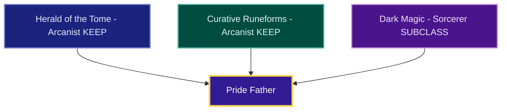

# Build Plan - Hya'cinthe: Pride Father (Apex Mystic Magicka Arcanist)

> **Character profile:** [hya_cinthe.md](hya_cinthe.md) — Level 50 Male Khajiit Arcanist, CP 1082, @SOLAEGIS (NA Megaserver). Pronouns: **he/him**.

Hya'cinthe is **Pride Father** — an **old-soul Abi** (Turkish older-brother respect: the steady center younger cats defer to), not a blood-clan chieftain and not a flower cipher. He walks alone with a companion at his side: **true solo** lead-runner and overland scholar. Lewis plays **one character at a time**; this kit never assumes Dextera or any alt holds the margin.

Combat is a **solo-first Magicka Uber**: **Herald of the Tome** KEEP (Fatecarver weapon) + **Curative Runeforms** KEEP (heal, Gate, ink) + **Dark Magic** SUBCLASS replacing **Soldier of Apocrypha** (Dark Deal sustain for long channels). Gear is **100% craftable** via @masisi — **Tide-Born Wildstalker** + **Order's Wrath** + **Armor of the Trainee** (no monster set, no mythics). Dual vocation: **Scribing** (ink and Contingency) and **Antiquities** (leads, Scrying, Excavation).

---

## Build at a glance

| **Attribute** | **Recommendation** |
| :--- | :--- |
| **Gender / Pronouns** | **Male** — **he/him** |
| **Alignment** | **Neutral Good** — Pride Father — protects found family; violence only to shield the circle |
| **Primary Stat** | 64 points in **Magicka** — **live:** 0 Mag / 0 Health / 64 Stam (Assassin leftover) · **target:** 64 Magicka |
| **Mundus Stone** | **The Shadow** — +Crit Damage / Crit Healing with Order's Wrath + Khajiit; **live:** The Thief |
| **Vampirism** | **Cure** — **live:** Stage 3 Vampire · living vitality for digs and overland |
| **Trinity** | **Herald of the Tome** KEEP · **Curative Runeforms** KEEP · **Dark Magic** SUBCLASS (replaces **Soldier of Apocrypha**) — **live:** Herald + Soldier + Assassination · **decision:** solo needs Dark Deal + Curative self-heal more than Soldier breach (breach from Elemental Drain) |
| **Sets** | **5 Tide-Born Wildstalker** + **5 Order's Wrath** + **2 Armor of the Trainee** — **100% craftable** · **live:** Trainee / Night Mother / Death's Wind / Julianos mix · **target:** gold craftable only (no Slimecraw / no dungeon sets) |
| **Bars** | Front: Lightning Destruction Staff ("Father's Beam") · Back: Inferno Destruction Staff ("Ink Bargain") |
| **Food** | **Witchmother's Potent Brew** (Max Magicka / Health / Mag Recovery) |
| **Potion** | **Essence of Spell Power** (Spell Crit / Spell Power / Magicka) |
| **Weapon Poisons** | Optional Absorb Magicka / Breach poisons on dig bosses; not required |
| **Staff/Weapon Enchant** | Front: **Flame Damage** (Infused) · Back: **Crushing** (Infused) for Major Breach uptime with Elemental Drain |
| **Companion** | **Primary (now):** **Tanlorin** (live) · **Secondary:** **Azandar al-Cybiades** (scholar / Scrying rapport) · **Goal (20/20 @ CP160):** **Bastian Hallix** (tank companion for world bosses and hard digs) |
| **Primary Mount** | **Ja'zennji Siir Fox** (owned) · **Ideal:** **Hermitage Servitor** — see [Collectibles](#collectibles) |
| **Flavor Pet** | **Abecean Ratter Cat** (owned) · **Ideal:** **Dusky Fennec Fox** · **Desk toy:** **Cipher's Eye Pocket Watcher** — see [Collectibles](#collectibles) |
| **Costume** | **Hollow Moon Garb** (owned) · **Alt:** **Quendelunn Veiled Heritance Garb** — see [Collectibles](#collectibles) |

**Read next:** [Roleplay](#roleplay-pride-father) · [Trinity configuration](#trinity-configuration) · [Combat kit](#combat-kit-pride-fathers-ink) · [Gear and crafting](#gear-and-crafting-abis-regalia) · [Champion points](#champion-point-mapping-cp-1082) · [Companion](#companion-strategy-the-circle-at-his-side) · [Collectibles](#collectibles) · [Checklist](#next-steps--in-game-action-checklist)

---

## Roleplay: Pride Father

In Rimmen they still say his soft name under their breath — **Hya'cinthe** — the private word his mother kept for quiet rooms. On the streets, in the guild halls, and anywhere a younger cat needs a fixed star, he is **Pride Father**: not a blood-pride warlord, but **Abi** — the older brother the circle looks up to. He earned it the slow way. Showing up. Listening twice. Putting his body between trouble and people who trust him. Old soul. Measured. Patient. When strangers mean no harm, he is kind and curious; when the stack is threatened, the Beast answers with Apocrypha's green fire.

He ran with the Hollow Moon when secrets were a form of care — hiding found family from knives that wanted soft targets — not as a hired Assassin for gold. The Assassination title never fit the man who would rather teach a younger scribe how to stand than sell a throat. He left that kit behind. Violence for hire is a younger cat's mistake; protection is a father's craft.

Apocrypha did not make him cruel. It made him hungry. Crux, ink, and runes became a craft he can teach by example: how to hold a beam without panic, how to bargain with Dark Deal when the channel empties you, how to bind a Contingency sentence before the dig turns ugly. He is gay without spectacle — quiet devotion, scholarly intimacy, a hand on a shoulder that means *I have you*. He/him.

His primary life is patient and solitary: **lead-runner**, overland walker, antiquarian with a pocket watcher and a fox under the moon. Companion at his side. Rare pugs only — never a fixed co-op fantasy. Dual vocation: **Scribing** (he does not merely cast; he **binds ink to a page**) and **Antiquities** (green leads first, then deeper strata). The title on his papers is simple and final: **Pride Father**.

> [!TIP]
> **Suggested Custom Title:** `Pride Father`

> [!NOTE]
> **Build Notes (paste into LAM Custom Title / Build Notes):**
> Pride Father — solo Mag Arcanist Abi / old soul. Herald + Curative KEEP; Dark Magic SUBCLASS (drops Soldier + Assassination). Father's Beam (Lightning): Blockade, Cephaliarch's Flail, Pragmatic Fatecarver, Escalating Runeblades, Recuperative Treatise, The Languid Eye. Ink Bargain (Inferno): Fulminating Rune, Dark Deal, Evolving Runemend, Elemental Drain, Contingency (or Fleet-Footed Gate), The Languid Eye (same morph both bars). Gear: 5 Tide-Born Wildstalker + 5 Order's Wrath + 2 Trainee — craftable only via @masisi (no monster). 64 Magicka. Mundus Shadow. Cure vamp. Spell Power pots. Scribing Contingency (Minor Force). Antiquities lead-runner. Companion: Tanlorin now; Azandar for Scrying; Bastian goal tank. Mount Ja'zennji Siir Fox; pet Abecean Ratter Cat; costume Hollow Moon Garb.

> [!TIP]
> **Flavor Pet:** **Abecean Ratter Cat** (owned; Neutral Good + cat affinity). **Ideal:** **Dusky Fennec Fox**. **Desk toy:** **Cipher's Eye Pocket Watcher** — see [Collectibles](#collectibles).

> [!TIP]
> **Costume:** **Hollow Moon Garb** — found-family care, not Assassin branding. **Alt:** **Quendelunn Veiled Heritance Garb**.

---

## Trinity configuration

### Subclassing decision (required)

Subclass unlocks at **Level 50** via Bahtra at-Hunding (**"A Study in Discipline"**). Hya is already 50. This build uses a legal **Arcanist Uber** (keep ≥1 native line; up to two foreign subclasses). See [docs/subclassing.md](../../../docs/subclassing.md).

**This build's decision:** **KEEP Herald of the Tome** and **KEEP Curative Runeforms**. **SUBCLASS Dark Magic** (Sorcerer) replacing **Soldier of Apocrypha**. Drop **Assassination** entirely (live leftover — not a target).

**Why not Apex Mystic (Herald + Dark Magic + Draconic)?** Pure beam DPS with Draconic breach is strong in groups, but Pride Father is a **true-solo** lead-runner. **Curative** owns self-heal, Gate mobility, and ink fantasy without needing a tank partner. **Dark Deal** keeps Fatecarver channels alive in digs and overland. Major Breach comes from **Elemental Drain** + **Crushing** glyph — Soldier's Runic Sunder is not required.

| **Pillar** | **Line** | **Origin** | **Slot action** | **Function** |
| :--- | :--- | :--- | :--- | :--- |
| **Weapon** | **Herald of the Tome** | Arcanist (native) | **KEEP** | **Cephaliarch's Flail** Crux; **Pragmatic Fatecarver** beam; **Escalating Runeblades** filler; **Recuperative Treatise**; **Fulminating Rune**; **The Languid Eye** (same morph both bars — cannot also take Unblinking) |
| **Ink / Survive** | **Curative Runeforms** | Arcanist (native) | **KEEP** | **Evolving Runemend** self-heal; **Fleet-Footed Gate** dig mobility until Contingency is scribed; Curative passives |
| **Engine** | **Dark Magic** | Sorcerer (subclass) | **SUBCLASS** (replaces **Soldier of Apocrypha**) | **Dark Deal** magicka sustain for long Fatecarver channels; drops Runic Sunder / Runeguard (breach via Dest instead) |

> [!IMPORTANT]
> **At respec:** Unslot every **Assassination** and **Soldier of Apocrypha** active. Slot **Dark Magic** morphs. Keep **Herald** and **Curative** passives and actives listed below. Do not re-slot Assassin Dual Wield kit.

---

## Combat kit: Pride Father's Ink

Open on the **Ink Bargain** (back) bar: drain, heal, Fulminating Rune, Contingency (or Gate). Swap to **Father's Beam**: Blockade → Flail → load Crux → **Pragmatic Fatecarver**. **Dark Deal** between channels. Pure magicka — 64 Magicka attributes. No Dual Wield, no Restoring Light, no Assassin morphs.

### Skill bars

Document **slotted morph names as shown in the skills UI**. Each morph appears at most once across bars. Both bars are Destruction Staff (Lightning front / Inferno back).

#### Front Bar (Lightning Staff): "Father's Beam"

| Slot | Skill | Line | Notes |
| :--- | :--- | :--- | :--- |
| 1 | **Elemental Blockade** | Destruction Staff | AoE DoT / weave for dig packs and world trash |
| 2 | **Cephaliarch's Flail** | Herald of the Tome | Primary Crux generator + heal on hit |
| 3 | **Pragmatic Fatecarver** | Herald of the Tome | Main beam; shield morph for solo mistakes |
| 4 | **Escalating Runeblades** | Herald of the Tome | Crux filler / single-target pressure |
| 5 | **Recuperative Treatise** | Herald of the Tome | Morph of Inspired Scholarship — Major Brutality / Sorcery + mag restore |
| Ultimate | **The Languid Eye** | Herald of the Tome | Morph of The Unblinking Eye — AoE dig packs / overland; **same morph on both bars** |

#### Back Bar (Inferno Staff): "Ink Bargain"

| Slot | Skill | Line | Notes |
| :--- | :--- | :--- | :--- |
| 1 | **Fulminating Rune** | Herald of the Tome | AoE rune DoT before beam windows |
| 2 | **Dark Deal** | Dark Magic | Magicka sustain — cast between Fatecarver channels |
| 3 | **Evolving Runemend** | Curative Runeforms | Solo self-heal |
| 4 | **Elemental Drain** | Destruction Staff | **Major Breach** + magicka restore (replaces Soldier Sunder) |
| 5 | **Contingency** *(scribed)* | Scribing | Prepared sentence — see [Scribing](#scribing); until unlocked use **Fleet-Footed Gate** |
| Ultimate | **The Languid Eye** | Herald of the Tome | Same ult as front — ESO allows one morph only (not Unblinking + Languid) |

> [!NOTE]
> **Pre-Scribing flex:** Slot **Fleet-Footed Gate** (Curative) in back slot 5 until Contingency is bound. Gate stays useful for dig repositioning — keep it on a flex bar or replace Contingency only when a dig needs sprint.

### Rotation

1. **Pre-pull (Ink Bargain):** Elemental Drain → Fulminating Rune → Evolving Runemend if low → Contingency (or Gate into position) → Dark Deal if mag is low.
2. **Swap to Father's Beam:** Elemental Blockade → Cephaliarch's Flail (build Crux) → weave light attacks → **Pragmatic Fatecarver** at 2–3 Crux.
3. **Sustain loop:** After channel, swap back → Dark Deal → refresh Drain / Fulminating / Contingency → beam again.
4. **Emergency:** Evolving Runemend; Gate out of AOE; potion; companion taunt if Bastian is out.
5. **Ultimate:** **The Languid Eye** from either bar on dig packs / world trash. (Alternate morph **The Unblinking Eye** is single-target — pick one morph account-wide, not both.)

### Passive skills

Prioritise: all **Herald of the Tome** combat passives; **Curative Runeforms** heal/cost passives; **Dark Magic** cost and Dark Deal passives; **Destruction Staff** Tri Focus / Ancient Knowledge / Destruction Expert; **Light Armor** (concentration / recovery); **Mages Guild** (Inner Light passive path — Major Savagery comes from Spell Power potion if Inner Light is not slotted); **Undaunted** Mettle; racial **Khajiit** Feline Ambush / robust.

### Scribing

Hya does not "cast a skill" in fiction — he **binds luminous ink to a prepared page**. Contingency is that sentence.

#### Beginner primer

1. **What it is:** A **Grimoire** (skill shell) + three **scripts** (Focus / Signature / Affix) bound with **Luminous Ink** at a Scribing altar.
2. **Unlock path:** Own the **Gold Road** chapter → complete the **Ulfsild / Scholarium** questline until the Scribing altar unlocks.
3. **Ink economy:** Luminous Ink drops from Scholarium content, dailies, and general play — check Journal / Scholarium vendors and solo-friendly overland sources. Exact drop tables change; farm what he can run alone.
4. **Script hunting:** Class scripts vs skill-line scripts. In the UI, read Focus (what the skill *does*), Signature (extra clause), Affix (usually a Major/Minor buff or utility).
5. **Anti-recipes for this build:** Do **not** scribe Affixes that grant **Major Brutality / Sorcery** or **Major Savagery / Prophecy** — **Recuperative Treatise** and Spell Power potions already cover those. Do not double Minor Force if another source already owns it.

#### This build's recipe card — Contingency

| Slot | Choice | Why |
| :--- | :--- | :--- |
| **Grimoire** | **Contingency** | Back-bar prepared buff / damage clause that fits ink fantasy |
| **Focus** | Damage or heal Focus (prefer Magic Damage for dig trash) | Keeps the page useful between beams |
| **Signature** | Magicka restore or critical Signature | Supports Fatecarver sustain / Khajiit crit |
| **Affix** | **Minor Force** | Crit damage without fighting Recuperative Treatise ownership |

Bind with Luminous Ink at the altar. Until scripts are collected, keep **Fleet-Footed Gate** in the Contingency slot.

---

## Gear and crafting: Abi's Regalia

### Set rationale

Calculator (`value_calc.py`) on solo-ish Mag baselines: **Tide-Born Wildstalker** (+~16% with monster-direct uptime) and **Order's Wrath** (+~11% crit package) beat Julianos, Clever Alchemist, and New Moon for this kit. Tide-Born's **15% direct damage vs monsters** is ideal for Antiquities dig spawns, overland, and world bosses. Order's Wrath stacks with Khajiit crit damage and Shadow mundus.

**No monster set.** No Slimecraw, no Molag Kena, no dungeon/trial/overland farm sets, no mythics. Head and shoulders are **Armor of the Trainee** (craftable 2pc Mag/Health/Stam).

### Target loadout

| Slot | Set | Trait | Enchant |
| :--- | :--- | :--- | :--- |
| Head | Armor of the Trainee | Divines | Max Magicka |
| Shoulders | Armor of the Trainee | Divines | Max Magicka |
| Chest | Tide-Born Wildstalker | Divines | Max Magicka |
| Hands | Tide-Born Wildstalker | Divines | Max Magicka |
| Waist | Tide-Born Wildstalker | Divines | Max Magicka |
| Legs | Tide-Born Wildstalker | Divines | Max Magicka |
| Feet | Tide-Born Wildstalker | Divines | Max Magicka |
| Necklace | Order's Wrath | Bloodthirsty | Spell Damage |
| Ring | Order's Wrath | Bloodthirsty | Spell Damage |
| Ring | Order's Wrath | Bloodthirsty | Spell Damage |
| Front staff (Lightning) | Order's Wrath | Infused | Flame Damage |
| Back staff (Inferno) | Order's Wrath | Infused | Crushing |

Weights: **5 Light** (Tide-Born body) + **Trainee** as needed for Undaunted Mettle (typically 5L / 1M / 1H once Trainee pieces are chosen to fill the weight rule — ask @masisi to match Undaunted 5/1/1 with light Tide-Born and mixed Trainee if preferred). Jewelry and both staves **Order's Wrath**.

### Crafting handoff (@masisi)

Ask **@masisi** (NA) for gold **CP160**:

- 5× **Tide-Born Wildstalker** body (Divines / Magicka)
- 2× **Armor of the Trainee** (head + shoulders; Divines / Magicka)
- 3× **Order's Wrath** jewelry (Bloodthirsty / Spell Damage)
- 2× **Order's Wrath** staves (Lightning + Inferno; Infused; Flame + Crushing)

Style preference: Hollow Moon / Apocrypha-adjacent motifs when researched — function first.

---

## Champion Point Mapping (CP 1082)

Spend toward combat; leave crafting stars only if needed for handoff alts.

### Warfare (blue)

**Slottables:** Fighting Finesse · Master-at-Arms · Wrathful Strikes · Biting Attacks (or Thaumaturge if DoT-heavy dig weeks).

**Passive priority:** Piercing · Precision · Eldritch Insight · Flawless Ritual · War Mage · Prepared · Elemental Aegis as needed.

### Fitness (red)

**Slottables:** Rejuvenation · Boundless Vitality · Fortified · Spirited (or Expert Evasion for dig traps).

**Passive priority:** Tumbling · Defiance · Hero's Vigor · Tireless Guardian · Fortification.

### Craft (green)

Minimal for this character once gear is crafted — Steed's Blessing / Gifted Rider for overland lead runs; Liquid Efficiency if potting heavily.

---

## Companion strategy: The Circle at His Side

Companion is the **only** reliable ally. Gear him seriously.

| Tier | Companion | Role | Loadout | Acquisition |
| :--- | :--- | :--- | :--- | :--- |
| **Primary (now)** | **Tanlorin** | Live DPS / utility | Keep current until Bastian ranks | Already unlocked |
| **Secondary** | **Azandar al-Cybiades** | Scholar — Scrying / Excavation rapport | Light damage + utility; bring on Antiquities sessions | Arcanist story / companion unlock |
| **Goal (20/20)** | **Bastian Hallix** | Tank companion for world bosses and hard digs | Companion's heavy + sword/board; taunt / shield skills | High Isle companion quests |

**Rapport tip:** Scrying and Antiquities activities raise Azandar rapport — pair lead days with him out.

---

## Collectibles

### Mount

| Pick | Name | Notes |
| :--- | :--- | :--- |
| **Primary** | **Ja'zennji Siir Fox** | Owned; Pride Father overland presence |
| **Ideal** | **Hermitage Servitor** | Apocrypha-adjacent scholar mount |

**Favorites (ESO Favorite Collectibles / Collections):** Ja'zennji Siir Fox, Highland Spotted Lynx, Noble Riverhold Senche-Lion, Sapiarchic Senche-Serval, Senche-Leopard, Spotted Duneracer Senche-raht — Neutral Good + cat affinity; owned thematic set only; enable random favorite mount when 2+ are favorited.

### Pet

| Pick | Name | Notes |
| :--- | :--- | :--- |
| **Primary** | **Abecean Ratter Cat** | Owned; Neutral Good + cat affinity |
| **Ideal** | **Dusky Fennec Fox** | Soft Rimmen companion energy |
| **Desk toy** | **Cipher's Eye Pocket Watcher** | Ink / lens fantasy only — not the overland flavor pet |

**Favorites:** Abecean Ratter Cat, Big-Eared Ginger Kitten, Housecat, Dusky Fennec Fox, Ambersheen Vale Fawn, Sylvan Nixad, Psijic Mascot Bear Cub — summon a random favorite vanity pet when 2+ are set.

### Costume

| Pick | Name | Notes |
| :--- | :--- | :--- |
| **Primary** | **Hollow Moon Garb** | Found-family care; not Assassin cosplay |
| **Alt** | **Quendelunn Veiled Heritance Garb** | Quiet scholar nights |

### Dye and style

Deep Apocrypha green, soft moon-silver trim, warm Rimmen gold accent. Avoid loud assassin black-red.

### Antiquarian practice

Beginner track for Pride Father as the account's **lead runner**:

1. **Unlock:** Join the **Antiquarians Guild** in **Western Skyrim** → unlock **Scrying** and **Excavation** skill lines.
2. **What a Lead is:** Inventory item → Scry at an antiquity desk / map → dig site appears → Excavate with tools.
3. **Progression:** Start **green** leads and simple tools; rank Scrying/Excavation; move to blue/purple/orange as tools and passives allow. Do not jump to orange digs under-tooled.
4. **Character rule:** Prefer leads that feel like **ink, lens, relic, or Apocrypha-adjacent** motifs/furnishings when choices exist; otherwise any green lead is valid practice.
5. **Companion:** Bring **Azandar** on scrying days for rapport.
6. **Habit:** Between overland quests, turn in one lead — patient old-soul hobby, not a race.

---

## Next Steps & In-Game Action Checklist

### Phase 0 — Respec off Assassin kit

1. **Cure Vampirism** (Stage 3 live → clean).
2. **Attributes:** Respec to **64 Magicka** (drop 64 Stam Assassin spread).
3. **Mundus:** Activate **The Shadow**.
4. **Subclass at Bahtra:** Confirm **Dark Magic** slotted; **Soldier of Apocrypha** and **Assassination** removed; **Herald** + **Curative** kept.
5. **Skill bars:** Match [Father's Beam](#front-bar-lightning-staff-fathers-beam) / [Ink Bargain](#back-bar-inferno-staff-ink-bargain) — Dual Wield / Restoring Light / Assassin morphs are **not** targets.
6. **Passives:** Herald, Curative, Dark Magic, Dest, Light Armor, Undaunted, racial.

### Phase 0b — Systems (Scribing + Antiquities)

7. **Antiquarians Guild** (Western Skyrim) early — unlock Scrying + Excavation; start green leads.
8. **Gold Road / Scholarium** — unlock Scribing altar; gather scripts + Luminous Ink for **Contingency** (Minor Force Affix). Until then, keep **Fleet-Footed Gate** in back slot 5.

### Phase 1 — Craft interim

9. **[Phase 1]** Ask @masisi for purple/gold **Tide-Born** body + **Order's Wrath** jewelry/staves + **Trainee** head/shoulders as pieces unlock. Deconstruct Assassin / Night Mother leftovers.

### Phase 2 — Craft target (Abi's Regalia)

10. **[Phase 2]** Full gold **5 Tide-Born + 5 Order's Wrath + 2 Trainee** per [Target loadout](#target-loadout). Transmute traits to Divines / Bloodthirsty / Infused. **No monster farm.**

### Phase 3 — Polish (ink, leads, companion)

11. **[Phase 3]** Bind **Contingency** recipe; daily green→blue lead habit; level **Bastian** toward 20/20 with Companion's tank gear; run Scrying sessions with **Azandar**.
12. **Food / pots:** Stock Witchmother's + Spell Power essences.
13. **Regenerate profile:** `/cm` and update [hya_cinthe.md](hya_cinthe.md) when bars, CP, and gear match.

May the ink hold, Abi. The pride looks to you.
