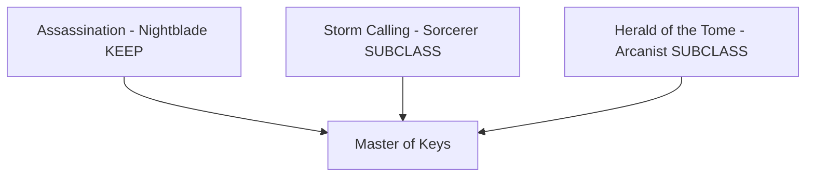
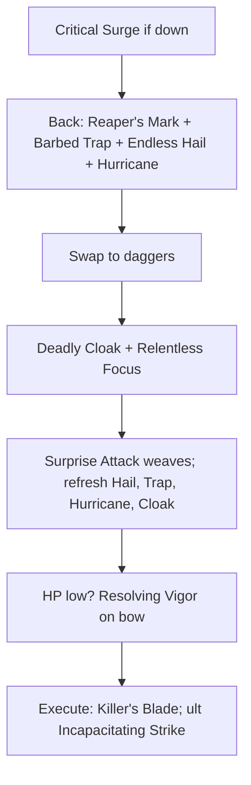
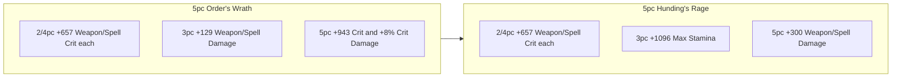

# Build Plan - Karakedi: The Master of Keys (Uber Stamina Nightblade)

> **Character profile:** [karakedi.md](karakedi.md) — Level 50 Male Khajiit Nightblade, CP 1109, @SOLAEGIS (NA). Pronouns: **he/him**.

Karakedi is a Neutral Evil Khajiit assassin who treats every fight as a lock: daggers are the keys, and the last click is the body hitting the floor. This plan is **Uber stamina Nightblade**, not peak-native. He **KEEP**s **Assassination** and **SUBCLASS**es **Storm Calling** (replaces **Siphoning**) plus **Herald of the Tome** (replaces **Shadow**) because those foreign lines already beat the natives on this solo craftable kit — **Critical Surge**, **Hurricane**, and Herald passives are live and they stay.

Live Karakedi is already on that Trinity at **CP 1109** with 64 Stamina, gold **5 Order's Wrath + 5 Hunding's Rage**, Dual Wield front / Bow back, and **The Thief**. The leftover work is food, jewelry glyphs, two skill points, leftover Champion Points, and Ember's healer bar — not a recraft and not a KEEP-all respec.

---

## Build at a glance

| **Attribute** | **Recommendation** |
| :--- | :--- |
| **Gender / Pronouns** | **Male** (from profile) — **he/him** |
| **Alignment** | **Neutral Evil** — Master of Keys — Dark Brotherhood locksmith; murder as craft |
| **Primary Stat** | 64 points in **Stamina** — **live:** 0 / 0 / 64 (Witchmother's, bow bar: 24,727 Health · 12,915 Magicka · 25,643 Stamina · Weapon Power 3,845) · **front-bar sheet (Main pair):** Weapon Power 4,106 · crit 62.7% · pen 2,338 · crit dmg 102% · **target:** 64 Stamina on **Garlic Cod with Potato Crust** |
| **Mundus Stone** | **The Thief** (crit rating; +1,982 with 7× Divines) — **live:** The Thief (equipped). Lover is only +1.9% in `value_calc.py`; do not swap for performance |
| **Vampirism** | **Never** — profile Never, not Cured |
| **Lycanthropy** | **Never** — mutually exclusive with active vampirism; he has neither |
| **Trinity** | **Assassination** KEEP · **Storm Calling** SUBCLASS (replaces **Siphoning**) · **Herald of the Tome** SUBCLASS (replaces **Shadow**) — **live:** Storm Calling + Herald [Full] · **decision:** Uber Max DPS already slotted |
| **Sets** | **5 Order's Wrath + 5 Hunding's Rage** (100% craftable, all medium + DW/bow/jewelry) — **live:** gold 5/5 + 5/5 · **target:** same pieces; jewelry glyphs only |
| **Bars** | Front: Dual Wield daggers ("The Locksmith's Keys") · Back: Bow ("The Long Latch") |
| **Food** | **Garlic Cod with Potato Crust** — stamina skills, Health 18,875 without a Health food is thin; Witchmother's spends the slot on unused Magicka · **Bewitched Sugar Skulls** only if world-boss dodge (cost 2,788) fails |
| **Potion** | **Crown Tri-Restoration Potion** (stock) · **Essence of Heroism** when the crowns run out |
| **Weapon Poisons** | Optional Damage Health on the daggers; not required |
| **Staff/Weapon Enchant** | Front: **Poison** MH / **Flame** OH · Back: **Weapon Damage** (Infused) |
| **Companion** | **Primary (now):** **Ember** (Healer) at live CP **1109** + companion **10/20** · **Secondary:** **Sharp-as-Night** · **Goal (20/20 @ CP160):** **Ember** (Healer) |
| **Primary Mount** | **Rahd-m'Athra** (owned) · **Ideal:** **Rahd-m'Athra** — see [Collectibles](#collectibles) |
| **Flavor Pet** | **Haunted House Cat** (owned) · **Ideal:** **Haunted House Cat** — see [Collectibles](#collectibles) |
| **Costume** | **Black Hand Robe** (owned) · **Alt:** **Thieves Guild Leathers** — see [Collectibles](#collectibles) |

**Read next:** [Roleplay](#roleplay-the-master-of-keys) · [Trinity configuration](#trinity-configuration) · [Combat kit](#combat-kit-the-locksmiths-cycle) · [Gear and crafting](#gear-and-crafting-the-locksmiths-arsenal) · [Champion points](#champion-point-mapping-cp-1109) · [Companion](#companion-strategy-the-assassins-code) · [Collectibles](#collectibles) · [Checklist](#next-steps--in-game-action-checklist)

---

## Roleplay: The Master of Keys

The profile title is **Assassin**. The fiction is still **The Master of Keys**. Karakedi does not only pick physical locks in Alinor; he unlocks the last barrier between a mark and the Void. He views every encounter as a puzzle. His daggers are the keys, and the red blood of his enemies is the final mechanism clicking into place. He is a high-society ghost — wealthy enough for the finest silks, lethal enough to vanish before the body hits the floor.

He keeps **Assassination** as the craft. Storm and Herald are tools he stole, not a new identity: the surge is the click of the tumblers, the hurricane is the room going dark.

> [!TIP]
> **Suggested Custom Title:** `Master of Keys`

> [!NOTE]
> **Build Notes (paste into LAM Custom Title / Build Notes):**
> Karakedi — Master of Keys. Khajiit assassin who treats every fight as a lock: daggers first, bow to set the pins. Uber Nightblade: KEEP Assassination; Storm Calling and Herald of the Tome replace Siphoning and Shadow. Dual Wield front ("The Locksmith's Keys"): Deadly Cloak, Surprise Attack, Killer's Blade, Relentless Focus, Critical Surge, Incapacitating Strike. Bow back ("The Long Latch"): Endless Hail, Hurricane, Barbed Trap, Reaper's Mark, Resolving Vigor, Toxic Barrage. 64 Stamina. Mundus: The Thief. Never vampire, never wolf. Gear: 5 Order's Wrath + 5 Hunding's Rage via @masisi. Companion: Ember heals; dismiss her before the Blade of Woe. Mount Rahd-m'Athra. Pet Haunted House Cat. Costume Black Hand Robe.

> [!TIP]
> **Flavor Pet:** **Haunted House Cat** — silent partner on the contract. **Ideal (any source):** **Haunted House Cat**. See [Collectibles](#collectibles).

> [!TIP]
> **Costume:** **Black Hand Robe** — Brotherhood silhouette for the Master of Keys. **Alt:** **Thieves Guild Leathers**. Full picks under [Collectibles](#collectibles).

---

## Trinity configuration

### Subclassing decision (required)

Subclass unlocks at **Level 50** via Bahtra at-Hunding (**"A Study in Discipline"**). Unlocking the quest makes subclassing *available*. See [docs/subclassing.md](../../../docs/subclassing.md).

**This build's decision:** **Uber.** **KEEP Assassination.** **SUBCLASS Storm Calling** replaces **Siphoning** because **Critical Surge** (Major Brutality / Major Sorcery + heal on weapon crit) and **Hurricane** (ramping Physical AoE + Major Resolve + Minor Expedition) outperform Siphoning's sustain kit on a 64-Stamina solo bar that already has **Resolving Vigor**. **SUBCLASS Herald of the Tome** replaces **Shadow** for unconditional passives (**Harnessed Quintessence**, **Psychic Lesion**, **Fated Fortune**) — no Fatecarver channel; passives only. Live export is already Storm + Herald [Full].

| **Pillar** | **Line** | **Origin** | **Slot action** | **Function** |
| :--- | :--- | :--- | :--- | :--- |
| **Weapon** | **Assassination** | Nightblade (native) | **KEEP** | Spammable (**Surprise Attack**), execute (**Killer's Blade**), bow-mark (**Reaper's Mark**), melee ult (**Incapacitating Strike**), **Relentless Focus** |
| **Engine** | **Storm Calling** | Sorcerer (subclass) | **SUBCLASS** (replaces **Siphoning**) | **Critical Surge** self-buff + heal-on-crit; **Hurricane** AoE and Major Resolve on the bow bar |
| **Edge** | **Herald of the Tome** | Arcanist (subclass) | **SUBCLASS** (replaces **Shadow**) | Passives only: Weapon/Spell Damage on resource return, status chance/damage. No Herald actives slotted |

> [!IMPORTANT]
> **Do not respec back to Shadow or Siphoning** for the main loadout. Those passives do nothing while the lines are unslotted — do not spend points on them. A **Soul Tether** delve bar needs Siphoning and is a **separate respec**, not this plan.

---

## Combat kit: The Locksmith's Cycle

Open on the bow to set Breach, Minor Force, Hail, and Hurricane. Swap to the daggers, keep **Critical Surge** and **Deadly Cloak** up, spam **Surprise Attack**, and execute with **Killer's Blade**. Melee is front; bow is back.

### Skill bars

Document **slotted morph names as shown in the skills UI**. Each morph appears at most once. Bars match equipped weapons (daggers front, bow back). **Incapacitating Strike** and **Soul Harvest** are both **Death Stroke** morphs — he can learn only one. Live is **Incapacitating Strike** front and **Toxic Barrage** (Bow **Rapid Fire**) back.

#### Front Bar (Dual Wield): "The Locksmith's Keys"

| **Slot** | **Class/Line** | **Base → Morph** | **Role** | **Profile** |
| :--- | :--- | :--- | :--- | :--- |
| **1** | Dual Wield | Blade Cloak → **Deadly Cloak** | AoE DoT + 20% AoE damage taken reduction | Live |
| **2** | Assassination | Veiled Strike → **Surprise Attack** | Stamina spammable; applies Minor Breach / armor shred | Live |
| **3** | Assassination | Assassin's Blade → **Killer's Blade** | Execute; Bloodthirsty jewelry starts paying here | Live |
| **4** | Assassination | Grim Focus → **Relentless Focus** | Stacks → spectral bow; burst and heal | Live |
| **5** | Storm Calling | Surge → **Critical Surge** | Major Brutality / Major Sorcery; heal on weapon crit | Live (do not swap to Power Surge) |
| **6 (Ult)** | Assassination | Death Stroke → **Incapacitating Strike** | Melee execute ultimate | Live |

#### Back Bar (Bow): "The Long Latch"

| **Slot** | **Class/Line** | **Base → Morph** | **Role** | **Profile** |
| :--- | :--- | :--- | :--- | :--- |
| **1** | Bow | Volley → **Endless Hail** | AoE Physical DoT | Live |
| **2** | Storm Calling | Lightning Form → **Hurricane** | Ramping Physical AoE, Major Resolve, Minor Expedition | Live |
| **3** | Fighters Guild | Trap Beast → **Barbed Trap** | Minor Force (+10% crit damage) | Live |
| **4** | Assassination | Mark Target → **Reaper's Mark** | Major Breach (−5,948 resist), heal on kill, Major Berserk | Live |
| **5** | Assault | Vigor → **Resolving Vigor** | Burst heal-over-time | Live |
| **6 (Ult)** | Bow | Rapid Fire → **Toxic Barrage** | Poison channel + follow-up DoT; CC immunity while channeling | Live |

### Rotation and combat tips

#### Solo combat tips

1. **Mark first.** **Reaper's Mark** is the Major Breach. Sheet pen is **2,338** on the dagger bar and **700** on the bow (Sharpened is front-only). In combat that is about **8,286** / **6,648** after Breach — still ~10k under the 18,200 PvE resist cap (cap is general ESO knowledge; re-check after patches). Do not drop the Mark for Night Mother's Gaze.
2. **Surge stays Critical.** Power Surge keys off critical **heals**. This kit heals from weapon crits — live **Critical Surge** is the right morph.
3. **Bow is setup, not the parse bar.** Refresh Hail / Hurricane / Trap, then live on the daggers. **Toxic Barrage** is ranged burst when you cannot close; swap to melee for **Incapacitating Strike**.
4. **Do not slot Dual Wield skills on the bow.** **Deadly Cloak** requires the daggers.

#### Alternative: Delve trash (optional)

For packed delves only, **Whirling Blades** (Dual Wield **Whirlwind**) can replace **Killer's Blade**. That is a trash swap, not a second trinity. **Soul Tether** needs **Siphoning** — Armory / respec only; it is not compatible with live Storm Calling.

### Passive skills

**2 skill points** available. Buy **Expert Mage II** first (Storm; +Weapon/Spell Damage per slotted Sorcerer ability — **Critical Surge** and **Hurricane**). Finish **Splintered Secrets II** on the next point. Do not buy Shadow or Siphoning passives while those lines are unslotted.

#### Nightblade — Assassination (KEEP)

* **Master Assassin (II), Executioner (II), Pressure Points (II), Hemorrhage (II)** — live maxed.

#### Sorcerer — Storm Calling (SUBCLASS)

* **Capacitor (II), Energized (II), Amplitude (II)** — live maxed.
* **Expert Mage (0/2) → II:** first two skill points.

#### Arcanist — Herald of the Tome (SUBCLASS)

* **Fated Fortune (II), Harnessed Quintessence (II), Psychic Lesion (II)** — live maxed.
* **Splintered Secrets (1/2):** finish on the next spare point after Expert Mage.

#### Weapon — Dual Wield / Bow

* **Focused Killer, Ambidextrous, Controlled Fury, Ruffian, Twin Blade and Blunt** — live maxed (two daggers).
* **Vinedusk Training, Accuracy, Ranger, Hawk Eye, Hasty Retreat** — live maxed. Bow ultimate unlocked.

#### Armor — Medium

* All Medium passives live maxed (seven pieces).

#### Guild — Fighters Guild

* **Intimidating Presence, Slayer (III), Skilled Tracker** — live.
* **Banish the Wicked (2/3):** finish when Fighters Guild rank allows. **Bounty Hunter** optional (Cyrodiil).

#### Race — Khajiit

* **Cutpurse, Robustness (III), Lunar Blessings (III), Feline Ambush (III)** — live maxed. Crit and recovery already in the sheet.

#### Alliance — Assault

* **Resolving Vigor** is slotted. Take **Continuous Attack** when Alliance rank allows. Do not spend filler points on **Reach**.

---

## Gear and crafting: The Locksmith's Arsenal

Built 100% on **craftable** sets. Live gold **5 Order's Wrath** (all medium body) + **5 Hunding's Rage** (daggers, jewelry, Infused bow) is already the target pairing. Values are CP160 gold from `query_sets.py` / `llm_digest.jsonl`.

### Set rationale

| **Set** | **5-Piece Bonus** | **Role in the Build** |
| :--- | :--- | :--- |
| **Order's Wrath** | +943 Critical Chance and **+8% Critical Damage / Critical Healing** (2/4pc +657 crit; 3pc +129 WD/SD) | Khajiit + Thief crit package; +8% of the 102% live crit-damage sheet |
| **Hunding's Rage** | +300 Weapon and Spell Damage (2/4pc +657 crit; 3pc +1,096 Stamina) | Always-on Weapon Damage floor for Surprise Attack and Killer's Blade |

> [!NOTE]
> **Why not Night Mother's Gaze?** 5pc Major Breach is worth **0** while **Reaper's Mark** is already on the bar. Order's Wrath and Hunding's share the same 2/4pc crit lines — swapping only drops the +8% crit damage and +300 WD for a duplicate debuff.
>
> **Why not recraft the main-hand Nirnhoned?** Live **Sharpened** is **+1,638** pen on a kit that sits ~10k under the resist cap after Breach. Nirnhoned is +15% **that weapon's** damage, not character damage. Keep Sharpened.
>
> **Why not Sharpened bow?** Back-bar Sharpened is about +6% on the setup bar in `value_calc.py` and drops the Infused **Weapon Damage** glyph that carries to the front bar after swap.

### Target loadout

Live pieces stay. The only **Respec** row is jewelry glyphs.

| **Slot** | **Set** | **Weight** | **Trait** | **Enchantment** | **Quality** |
| :--- | :--- | :--- | :--- | :--- | :--- |
| **Head** | Order's Wrath | Medium | Divines | Max Stamina | Gold — Live |
| **Shoulders** | Order's Wrath | Medium | Divines | Max Stamina | Gold — Live |
| **Chest** | Order's Wrath | Medium | Divines | Max Stamina | Gold — Live |
| **Hands** | Order's Wrath | Medium | Divines | Max Stamina | Gold — Live |
| **Waist** | Order's Wrath | Medium | Divines | Max Stamina | Gold — Live |
| **Legs** | Order's Wrath | Medium | Divines | Max Stamina | Gold — Live |
| **Feet** | Order's Wrath | Medium | Divines | Max Stamina | Gold — Live |
| **Neck** | Hunding's Rage | Jewelry | Bloodthirsty | **Increase Physical Harm** (174 WD) | Gold — **Respec** (live Multi-Effect) |
| **Ring 1** | Hunding's Rage | Jewelry | Bloodthirsty | **Increase Physical Harm** (174 WD) | Gold — **Respec** (live Multi-Effect) |
| **Ring 2** | Hunding's Rage | Jewelry | Bloodthirsty | **Increase Physical Harm** (174 WD) | Gold — **Respec** (live Multi-Effect) |
| **Front Main** | Hunding's Rage (Dagger) | 1H | Sharpened | Poisoned Weapon | Gold — Live |
| **Front Off** | Hunding's Rage (Dagger) | 1H | Charged | Fiery Weapon | Gold — Live |
| **Back Weapon** | Hunding's Rage (Bow) | 2H | Infused | Weapon Damage | Gold — Live |

**Front bar — Dual Wield:** Sharpened MH is the pen on the parse bar. Charged OH + flame feeds Herald **Psychic Lesion** status chance. Bloodthirsty jewelry is valued at roughly half of the +350 WD tooltip (scales under 90% Health).

**Back bar — Bow:** Two-hander counts as **2** Hunding's pieces. Infused (+30% enchant) on Weapon Damage (+348 WD for 5s) is the swap buff. Armor and jewelry count on both bars.

`value_calc.py` (front combat base `crit_pct=62.7,cd=102,pen=8286,power=4106,res=25643`): three Physical Harm glyphs ≈ **+5.3%**; Garlic Cod extra Stamina ≈ **+7.2%** vs a no-stam-food sheet; Lover instead of Thief only **+1.9%**.

### Crafting handoff (@masisi)

| **Detail** | **Recommendation** |
| :--- | :--- |
| **Style** | Dark Brotherhood / Thieves Guild / Khajiit — whatever @masisi has researched |
| **Set station** | Order's Wrath (High Isle, Steadfast Hammer and Saw — 3 traits) · Hunding's Rage (overland stations — 6 traits) |
| **Traits** | Divines (armor), Bloodthirsty (jewelry), Sharpened (MH dagger), Charged (OH), Infused (bow) |
| **Interim (pre-target)** | **None.** Live gold is the target. Do not recraft the daggers or bow |
| **Quality path** | Already gold. Enchanter work only: three **Glyph of Increase Physical Harm** |

> [!NOTE]
> **Research gate:** Pieces exist. Coordinate glyphs with @masisi if he holds the runes. Spec: [`karakedi_crafting.md`](../../fixtures/karakedi_crafting.md). See [`masisi.md`](masisi.md) for the account crafter.

---

## Champion Point Mapping (CP 1109)

> [!NOTE]
> **Star catalog:** Exact names, max points, and slottable vs passive from [`champion_points_reference.md`](../../templates/champion_points_reference.md) (YAML: [`champion_points.yaml`](../../templates/champion_points.yaml)). **4** slotted stars per discipline at 900+ total CP. Walk `prerequisites` (ancestor minimums before children).

Full CP budget: **370 Warfare / 370 Craft / 369 Fitness** (1109 total). Live: **368 / 370 / 338** spent, **2 Warfare** and **31 Fitness** free.

**Planning rules:**

- **Per-discipline cap:** 370 / 370 / 369 at CP 1109 (`total ÷ 3`).
- **Slotted stars:** **4** per discipline. Live Fitness also has **Bloody Renewal 50** assigned — keep it if the client still shows it; catalog cap is 4. Do not add a sixth.
- **Passives:** never consume a slot; spend in catalog stage increments.

### Warfare (Blue — 370 Points)

Ancestor path: **Precision 10** unlocks Fighting Finesse; **Piercing 10** unlocks Master-at-Arms and Deadly Aim. Live already walked that tree.

| **Slotted Star** | **Spend** | **Benefit** |
| :--- | :--- | :--- |
| **Fighting Finesse** | 50 points | +8% Critical Damage and Critical Healing |
| **Master-at-Arms** | 50 points | Direct-damage increase (Surprise Attack, Killer's Blade, ult) |
| **Deadly Aim** | 50 points | Single-target increase |
| **Backstabber** | 50 points | Crit damage vs flanked targets (Ember often holds aggro) |

**Passives (no slot needed — 170 points after the 2-point spend):**

* **Precision (20/20):** Fighting Finesse ancestor
* **Piercing (20/20):** +700 Offensive Penetration
* **Battle Mastery (40/40):** Martial status chance — live
* **Mighty (30/30):** Martial attack Weapon Damage — live
* **Tireless Discipline (20/40):** live; do not dump leftover here (only 2 Warfare free)
* **Quick Recovery (20/20):** live
* **Preparation (18/20 → 20/20):** spend the **2** free Warfare points

200 slotted + 170 passives = **370**.

### Fitness (Red — 369 Points)

Live slottables stay. Spend the **31** free points on passives already unlocked (no new star — all three targets have live points, so prerequisites are already satisfied).

| **Slotted Star** | **Spend** | **Benefit** |
| :--- | :--- | :--- |
| **Boundless Vitality** | 50 points | +1,400 Max Health |
| **Fortified** | 50 points | Armor |
| **Rejuvenation** | 50 points | +90 Health, Magicka, and Stamina Recovery |
| **Celerity** | 50 points | Movement speed (overland assassin) |
| **Bloody Renewal** | 50 points | Stamina on kill — **live extra slottable**; keep if still slotted |

**Passives (spend 28 of 31; bank 3):**

* **Hasty (16/16):** live max
* **Hero's Vigor (20/20):** live max
* **Piercing Gaze (27/30 → 30/30):** spend **3**
* **Mystic Tenacity (10/20 → 20/20):** spend **10**
* **Tumbling (15/30 → 30/30):** spend **15** (dodge cost)

338 + 28 = **366**. Catalog has no 1-point Fitness stage; **bank 3**.

### Craft (Green — 370 Points)

Live is already **370/370**. Do not reshuffle.

| **Slotted Star** | **Spend** | **Benefit** |
| :--- | :--- | :--- |
| **Steed's Blessing** | 50 points | Out-of-combat move speed |
| **Sustaining Shadows** | 50 points | Sneak / out-of-combat sustain |
| **Master Gatherer** | 30 points | Live partial (max 75) — leave it |

**Passives (live — do not touch):**

* **Out of Sight (30/30), Treasure Hunter (50/50), Rationer (30/30), Liquid Efficiency (50/50), Fleet Phantom (40/40)**
* **Steadfast Enchantment (10/50), Wanderer (10/50), Fortune's Favor (10/50), Gilded Fingers (10/50)**

---

## Companion Strategy: The Assassin's Code

Companion gear is separate from player gear — companions equip **Companion's** weapons, armor, and jewelry with **companion-only traits** (Quickened, Aggressive, Bolstered). There are no player gear sets or 5-piece bonuses on companions.

> [!NOTE]
> **Live export:** **Ember** — Level **10/20**, Companion's Restoration Staff (Epic, duration trait), Companion's Helmet (Superior), bar **Rejuvenation / Quick Fix / Entomb / empty**. Character **Level 50 / CP 1109**. Companion gear has **no item level** — ignore `(Level 1)` / outdated-gear warnings. Finish her healer bar before chasing 20.

### Companion picks

| **Tier** | **Companion** | **Role** | **Roleplay fit** | **Mechanical fit (at current stats)** |
| :--- | :--- | :--- | :--- | :--- |
| **Primary (now)** | **Ember** | Healer / Support | Arcane partner who keeps the locksmith standing | At 10/20 she already has resto + Quick Fix. Empty slots waste the glass-cannon parse |
| **Secondary** | **Sharp-as-Night** | Mercenary DPS / backup | Argonian hire who does not lecture a Brotherhood contract | When Ember is down or rapport-blocked; dismiss him for Blade of Woe the same way |
| **Goal (20/20 @ CP160)** | **Ember** | Full healer | Capped ward + Parallel for more Incapacitating Strike | Light Quickened resto, full support bar |

### Goal companion — Ember: The Arcane Healer

If Karakedi is the blade, Ember is the ward.

| **Setting** | **Recommendation** |
| :--- | :--- |
| **Role** | Healer / Combat Support |
| **Gear Weight** | 7/7 Light Companion Armor |
| **Gear Trait** | **Quickened** (cooldowns) |
| **Loadout** | Full Light Companion Armor + **Companion's Restoration Staff** |
| **Acquisition** | White basics from merchant clothiers/woodworkers; **Superior+** Quickened pieces from drops while she is active. **Not** part of the @masisi player craft |

#### Ember's support skill bar (goal @ 20/20)

1. **Shared Ward** (Playful Mischief): Shield and HoT for both.
2. **Quick Fix** (Playful Mischief): Burst heal — already live.
3. **Rejuvenation** (Restoration Staff): Ground HoT — already live.
4. **Parallel** (Playful Mischief): Lowers his Ultimate cost.
5. **Vanish** (Playful Mischief): She drops aggro and heals herself.
6. *Ultimate:* **Raging Storm** — AoE burst when the pack is marked.

### Primary now — Ember

She is already the pick. Level **10 → 20**, fill the empty slots, drop **Entomb** for **Shared Ward** / **Parallel** / **Vanish** as they unlock. Farm **Companion's** Light Quickened. Do not put Order's Wrath or Hunding's on her.

> [!TIP]
> **Secondary — Sharp-as-Night:** Summon him when Ember is dead, locked out, or you want a quieter hire. Same companion-only gear rules.

> [!IMPORTANT]
> **The Dismiss Tactic:** Companions lose rapport if they witness the **Blade of Woe** on an innocent. **Dismiss** Ember (Collectibles or a hotkey) before the contract. Summon her after the body is hidden.

---

## Collectibles

### Mount

A Khajiit assassin rides a Khajiit nightmare, not a courier horse.

> [!NOTE]
> **Owned mounts (from profile):** Rahd-m'Athra, Sapiarchic Senche-Serval, Highland Spotted Lynx, Nightmare Senche, and the rest of the NA pool in [karakedi.md](karakedi.md). Primaries below are owned.

#### Primary (owned): Rahd-m'Athra

| **Attribute** | **Detail** |
| :--- | :--- |
| **Why** | Dark Khajiit senche — Void-touched locksmith, unused as an NA primary |
| **Acquisition** | Owned ✅ |
| **Dye pass** | Obsidian / dried-blood red if the mount dyes |

#### Other owned options

| **Mount** | **Owned** | **Why** |
| :--- | :--- | :--- |
| **Sapiarchic Senche-Serval** | ✅ | High-society Alinor ghost |
| **Highland Spotted Lynx** | ✅ | Quiet overland cat |
| **Nightmare Senche** | ✅ | Heavier Daedric read |

#### Avoid thematically

| **Mount type** | **Reason** |
| :--- | :--- |
| **Bright / carnival / jester mounts** | No Misrule framing |
| **Imperial parade horses** | Magistrate fantasy belongs to Pelatiah |

> [!TIP]
> **Ideal mount (any source):** **Rahd-m'Athra** — already owned. No Crown chase required.

#### Favorites (ESO Favorite Collectibles / Collections)

Rahd-m'Athra, Sapiarchic Senche-Serval, Highland Spotted Lynx, Nightmare Senche — already in `PlanFavorites.lua` for Karakedi. Enable random favorite mount (2+ favorites). Do not pin a single horse.

### Pet

#### Primary (owned): Haunted House Cat

| **Attribute** | **Detail** |
| :--- | :--- |
| **Why** | Silent partner; S-tier on the NA shortlist; unused as an NA primary |
| **Acquisition** | Owned ✅ |

#### Other owned options

| **Pet** | **Why** |
| :--- | :--- |
| **Abecean Ratter Cat** (owned) | Alinor alley cat — keep in Favorites |
| **Long-Winged Bat** (owned) | Night contract silhouette |
| **Dusky Fennec Fox** (owned) | Desert nights (he is in Alik'r) |

> [!TIP]
> **Ideal pet (any source):** **Haunted House Cat** — already owned.

#### Favorites (ESO Favorite Collectibles / Collections)

Abecean Ratter Cat, Haunted House Cat, Long-Winged Bat, Dusky Fennec Fox — already in `PlanFavorites.lua`. Summon a random favorite vanity pet when 2+ are set.

### Costume

Full-body **costumes** (Collections → Appearance → Costumes), not Outfit Station motifs.

#### Primary: Black Hand Robe

| **Attribute** | **Detail** |
| :--- | :--- |
| **Why** | Dark Brotherhood — Master of Keys, unused as an NA primary |
| **Acquisition** | Owned ✅ |
| **Dye notes** | Black / dried blood / dull gold if the costume dyes |

#### Alt / situational

| **Costume** | **When to wear** |
| :--- | :--- |
| **Thieves Guild Leathers** | Heist nights / Alinor society ghost |
| **Shrouded Armor** | Field kit when the robe is too formal |
| **None (Outfit Station only)** | When showing the all-medium Order's Wrath body |

### Dye and style

**Visual Theme: Master of Keys**

| **Slot** | **Style** | **Visual reasoning** |
| :--- | :--- | :--- |
| **Outfit** | Dark Brotherhood / Thieves Guild / Khajiit | High-society ghost when not in the Black Hand Robe |

**Dye palette:** **Obsidian Black** (cloth), **Dried Blood Red** (accents), **Dull Gold** (hardware).

---

## Next Steps & In-Game Action Checklist

Sets are already gold. Do not recraft pieces that only need a glyph or a food swap.

### Phase 0 — Today (functional build)

1. **Food:** Eat **Garlic Cod with Potato Crust** (@masisi cook, or buy). Drop Witchmother's Brew for this kit.
2. **Skill points:** Spend **2** on **Expert Mage II**.
3. **Champion Points:** Warfare **Preparation 18 → 20**. Fitness **Piercing Gaze 27 → 30**, **Mystic Tenacity 10 → 20**, **Tumbling 15 → 30**. Bank 3 Fitness.
4. **Ember:** Fill empty slots (Shared Ward / Parallel / Vanish as they unlock). Assign a **dismiss/summon** hotkey for Blade of Woe.
5. **Bars / mundus / attributes:** Confirm live bars, **The Thief**, 64 Stamina. Do not subclass back to Shadow or Siphoning.

### Phase 1 — Glyphs

6. **[Phase 1]** Enchanter: three **Glyph of Increase Physical Harm** on the live Hunding's necklace and rings. Do not recraft the jewelry.

### Phase 2 — Craft (target)

7. **[Phase 2]** **None.** Body, weapons, and jewelry sets are already gold target. Skip this phase unless a piece is actually missing.

### Phase 3 — Polish

8. **[Phase 3]** Optional Lover mundus A/B parse (+1.9% in the calculator). Default remains **The Thief**.
9. **[Phase 3]** Finish **Splintered Secrets II** and **Banish the Wicked III** when points / Fighters Guild rank allow.
10. **Favorites (ESO Favorite Collectibles):** Confirm the lists under [Collectibles](#collectibles); `/efc applyplans` if they drifted.

### Finish

11. **Companion:** Level **Ember** 10 → 20. Light Companion's Quickened resto. Keep **Sharp-as-Night** as secondary.
12. **Costume:** Equip **Black Hand Robe** (or Thieves Guild Leathers in the field).
13. **Regenerate profile:** Run `/cm` in-game and update [karakedi.md](karakedi.md) when food, glyphs, CP, and Ember's bar are live.

---

## Appendix: Champion Point star catalog

All Warfare, Fitness, and Craft stars with constellation, type, and max points:

**[`champion_points_reference.md`](../../templates/champion_points_reference.md)**
