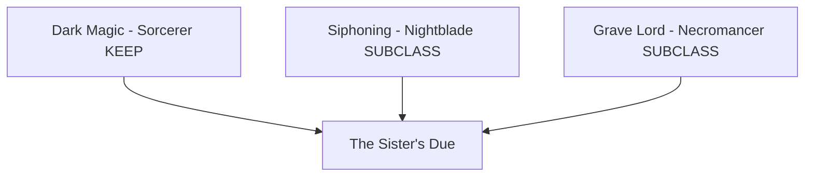
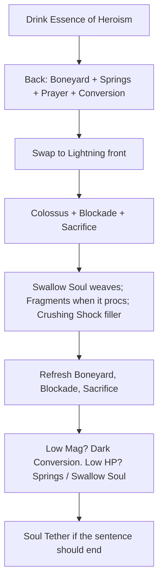
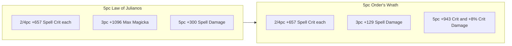

# Build Plan - Lætha: The Sister's Due (Uber Magicka Dark Executioner)

> **Character profile:** [laetha.md](laetha.md) — Level 50 Female High Elf Sorcerer, CP 1110, @SOLAEGIS (NA). Pronouns: **she/her**.

Lætha was a Summerset prodigy and a beauty beyond compare. A jealous sister compromised a spell she was testing; the backlash burned her face and half her body. She took her sister's life in payment. Everything since is collection. She wears the scars with pride — a taunt, so others fear her. Pity is an insult.

This plan is **Uber magicka Dark Executioner**, not peak native Sorcerer. She **KEEP**s **Dark Magic** and **SUBCLASS**es **Siphoning** (replaces **Storm Calling**) plus **Grave Lord** (replaces **Daedric Summoning**). Live Overview already lists those two subclasses; the bars still mix unmorphed Grave Lord, Strife, Crystal Fragments, stamina **Resolving Vigor**, and a dual-wield back bar on 5 Hunding's Rage + 3 Briarheart. Recraft to **Law of Julianos** + **Order's Wrath** via **@masisi**. Distinct from NA [brontanax_plan.md](brontanax_plan.md) (Storm + Daedric + Grave Lord). She is a loner, which is why she and **Sharp-as-Night** get along. **Zerith-var** is the older brother she never had — she bitches about him and keeps him anyway.

---

## Build at a glance

| **Attribute** | **Recommendation** |
| :--- | :--- |
| **Gender / Pronouns** | **Female** (from profile) — **she/her** |
| **Alignment** | **Lawful Evil** — the sister-killing was **payment**, a closed account, not a spree; siphon and grave-work collect every debt after that first one |
| **Primary Stat** | 64 points in **Magicka** — **live:** 64 Mag / 0 Health / 0 Stam (19,824 Health · 23,268 Magicka · 18,299 Stamina · 3,023 Spell Power) · **target:** 64 Magicka |
| **Mundus Stone** | **The Shadow** (+11% Critical Damage; +17% with 7× Divines — `mundus.json`) — **live:** The Shadow (equipped). Live 20% crit is the Hunding's/Briarheart problem, not the stone |
| **Vampirism** | **Never** — profile Never, not Cured |
| **Lycanthropy** | **Never** — mutually exclusive with active vampirism; she has neither |
| **Trinity** | **Dark Magic** KEEP · **Siphoning** SUBCLASS (replaces **Storm Calling**) · **Grave Lord** SUBCLASS (replaces **Daedric Summoning**) — **live:** Siphoning + Grave Lord [Conditional]; bars still use Dark Magic · **decision:** Uber warrant kit; Storm is Brontanax's niche; no Daedric pets |
| **Sets** | **5 Law of Julianos + 5 Order's Wrath** (100% craftable, 5-1-1) — **live:** Hunding's Rage 5/5 + Briarheart 3/5 · **target:** Julianos light body + lightning Precise, Order's Wrath heavy head / medium shoulders / jewelry + resto Infused Crusher |
| **Bars** | Front: Lightning Destruction Staff ("The Pallid Warrant") · Back: Restoration Staff ("The Writ of Ending") |
| **Food** | **Solitude Salmon-Millet Soup** — magicka skills, live Health 19,824 is thin, dest/resto + Dark Conversion + Swallow Soul + High Elf Spell Recharge cover sustain · drop live **Witchmother's Brew** after the resto bar is up · **buy** Artaeum Pickled Fish Bowl for 2h convenience · **Bewitched Sugar Skulls** only if world-boss dodge fails |
| **Potion** | **Essence of Heroism** (U51: Major Brutality + Major Savagery) |
| **Weapon Poisons** | None (use staff glyphs) |
| **Staff/Weapon Enchant** | Front: **Flame Damage** (Precise Lightning) · Back: **Crusher** (Infused Restoration) |
| **Companion** | **Primary (now):** **Sharp-as-Night** (ranged DPS) at live CP **1110** + companion **18/20** · **Secondary:** **Zerith-var** (start leveling; she will say he talks too much) · **Goal (20/20 @ CP160):** **Zerith-var** (heal/support — older brother who never gives up) |
| **Primary Mount** | **Nix-Ox War-Steed** (owned) · **Alt:** **Rubyflare Torchnix** (owned) — she prefers nix-oxen — see [Collectibles](#collectibles) |
| **Flavor Pet** | **Stonefire Scamp** (owned) · **Ideal:** **Stonefire Scamp** — see [Collectibles](#collectibles) |
| **Costume** | **Dark Seducer** (owned) · **Alt:** **Golden Saint** / **Elven Hero Armor** — scars stay visible — see [Collectibles](#collectibles) |

**Read next:** [Roleplay](#roleplay-the-sisters-due) · [Trinity configuration](#trinity-configuration) · [Combat kit](#combat-kit-the-pallid-warrant) · [Gear and crafting](#gear-and-crafting-the-burned-warrant) · [Champion points](#champion-point-mapping-cp-1110) · [Companion](#companion-strategy-the-quiet-and-the-lecture) · [Collectibles](#collectibles) · [Checklist](#next-steps--in-game-action-checklist)

---

## Roleplay: The Sister's Due

She was supposed to be the pretty one who never missed a weave. Summerset said so. Then her sister put a fault in a test spell, and fire took her face and half her body. Lætha closed that account. The Brotherhood named the woman who finished the sentence **Dark Executioner**. She did not take the title as costume. She took it as a warrant.

She does not veil the burns. She wears them with pride so the room looks and flinches. The Dark Seducer silhouette is the beauty she refuses to surrender; the fire on her skin is the rest of the sentence. Crystal Fragments is the compromised weave turned into a tool. Swallow Soul and Grave Lord are how she collects. She is a loner. Kin taught her what company costs. **Sharp-as-Night** is the quiet she admits to — two people who do not fill the silence and do not offer pity. **Zerith-var** is the older brother she never had. He never gives up. He believes in second chances. She claims he annoys her and she bitches about him all the time. She will not say that his loyalty, and that he likes her, is the part she keeps.

> [!TIP]
> **Suggested Custom Title:** `The Sister's Due`

> [!NOTE]
> **Build Notes (paste into LAM Custom Title / Build Notes):**
> Lætha — The Sister's Due. Summerset prodigy whose jealous sister sabotaged a test spell and burned her face and half her body. She took her sister's life in payment. She wears the scars with pride so others fear her. Uber Dark Executioner: KEEP Dark Magic; Siphoning and Grave Lord replace Storm Calling and Daedric Summoning. Lightning front ("The Pallid Warrant"): Elemental Blockade, Crystal Fragments, Swallow Soul, Grave Lord's Sacrifice, Crushing Shock, Pestilent Colossus. Resto back ("The Writ of Ending"): Healing Springs, Combat Prayer, Dark Conversion, Unnerving Boneyard, Degeneration, Soul Tether. 64 Magicka. Mundus: The Shadow. Never vampire, never wolf. Gear: 5 Law of Julianos + 5 Order's Wrath via @masisi. Sharp-as-Night now (loner quiet). Zerith-var Goal — older brother she bitches about and keeps. Mount Nix-Ox War-Steed. Pet Stonefire Scamp. Costume Dark Seducer.

> [!TIP]
> **Flavor Pet:** **Stonefire Scamp** — her fire familiar, kept in the open as part of the taunt. **Ideal:** the same scamp. See [Collectibles](#collectibles).

> [!TIP]
> **Costume:** **Dark Seducer** — beauty silhouette she will not give up; burns stay visible. **Alt:** **Golden Saint** or **Elven Hero Armor**. No veil, no hood.

---

## Trinity configuration

### Subclassing decision (required)

Subclass unlocks at **Level 50** via Bahtra at-Hunding (**"A Study in Discipline"**). Lætha is already 50. Overview lists Siphoning + Grave Lord **[Conditional]**. Daedric Summoning and Storm Calling show as rank-50 leftovers with **0 passives** — do not spend on them. See [docs/subclassing.md](../../../docs/subclassing.md).

**This build's decision:** **KEEP Dark Magic.** **SUBCLASS Siphoning** replaces **Storm Calling** because **Swallow Soul** (magicka damage + heal), **Magicka Flood**, and **Soul Siphoner** beat Storm's **Hurricane** / **Critical Surge** on a 64-Mag dest/resto bar (Hurricane is stamina; Storm is Brontanax's niche). **SUBCLASS Grave Lord** replaces **Daedric Summoning** because **Pestilent Colossus** (Major Vulnerability), **Grave Lord's Sacrifice**, **Unnerving Boneyard** (Major Breach), and **Death Knell** / **Dismember** beat pet slot-tax. This plan uses **no persistent pets** — a Twilight or atronach would require the same summon on **slot 5 of both bars**.

| **Pillar** | **Line** | **Origin** | **Slot action** | **Function** |
| :--- | :--- | :--- | :--- | :--- |
| **Weave** | **Dark Magic** | Sorcerer (native) | **KEEP** | **Crystal Fragments** proc, **Dark Conversion** mag sustain, **Degeneration** DoT. The compromised spell, kept |
| **Collection** | **Siphoning** | Nightblade (subclass) | **SUBCLASS** (replaces **Storm Calling**) | **Swallow Soul** mag damage + heal; **Soul Tether** execute; Magicka Flood / Soul Siphoner. Proof: Storm's Hurricane is stamina and is Brontanax's kit |
| **Sentence** | **Grave Lord** | Necromancer (subclass) | **SUBCLASS** (replaces **Daedric Summoning**) | **Grave Lord's Sacrifice**, **Unnerving Boneyard** Major Breach, **Pestilent Colossus** Major Vulnerability, Death Knell +12% crit with three GL skills. Proof: no pet on slot 5 |

> [!IMPORTANT]
> **She is already 50.** Confirm Siphoning + Grave Lord stay slotted with Dark Magic. Unslot Storm Calling and Daedric Summoning actives. Do not buy Storm or Daedric passives — they do nothing while those lines are unslotted.

---

## Combat kit: The Pallid Warrant

Open on the resto back bar: Major Breach, heals, Dark Conversion. Swap to the lightning front bar for Blockade, Sacrifice, Fragments, and Colossus. No Daedric summon — slot 5 is free on both bars.

### Skill bars

Document **slotted morph names as shown in the skills UI**. Each morph appears at most once. Bars must match equipped weapons (Lightning front, Restoration back).

> [!IMPORTANT]
> **No Daedric summons.** Do not slot Twilight, Clannfear, or atronach. A summon on only one bar despawns on swap. This kit uses Crushing Shock and Degeneration in slot 5 instead.

#### Front Bar (Lightning Destruction Staff): "The Pallid Warrant"

| **Slot** | **Class/Line** | **Base → Morph** | **Role** | **Profile** |
| :--- | :--- | :--- | :--- | :--- |
| **1** | Destruction Staff | Wall of Elements → **Elemental Blockade** | Shock ground (must match Lightning) | Respec (live **Wall of Storms**) |
| **2** | Dark Magic (Sorc) | Crystal Shard → **Crystal Fragments** | Proc spammable — the compromised weave | Live |
| **3** | Siphoning (NB) | Strife → **Swallow Soul** | Magicka damage + heal | Respec (live unmorphed **Strife**) |
| **4** | Grave Lord (Necro) | Sacrificial Bones → **Grave Lord's Sacrifice** | Death-aspect self-buff | Respec (live unmorphed **Sacrificial Bones**) |
| **5** | Destruction Staff | Force Shock → **Crushing Shock** | Filler / interrupt when Fragments is down | Respec (replaces **Resolving Vigor** — stamina, drop) |
| **6 (Ult)** | Grave Lord (Necro) | Frozen Colossus → **Pestilent Colossus** | **Major Vulnerability** on pull | Respec (live unmorphed **Frozen Colossus**) |

#### Back Bar (Restoration Staff): "The Writ of Ending"

| **Slot** | **Class/Line** | **Base → Morph** | **Role** | **Profile** |
| :--- | :--- | :--- | :--- | :--- |
| **1** | Restoration Staff | Grand Healing → **Healing Springs** | AoE heal | Respec (live bar is dual wield) |
| **2** | Restoration Staff | Blessing of Protection → **Combat Prayer** | Minor Berserk / resolve on the group of one | Respec |
| **3** | Dark Magic (Sorc) | Dark Exchange → **Dark Conversion** | Magicka sustain — **not Dark Deal** | Respec (live unmorphed **Dark Exchange**) |
| **4** | Grave Lord (Necro) | Boneyard → **Unnerving Boneyard** | **Major Breach** (−5,948 Resistance) | Respec |
| **5** | Dark Magic (Sorc) | Entropy → **Degeneration** | Magicka DoT + heal | Respec (replaces **Soul Splitting Trap**) |
| **6 (Ult)** | Siphoning (NB) | Soul Shred → **Soul Tether** | Execute / pull | Respec (live repeats Colossus) |

Three Grave Lord skills slotted (**Sacrifice**, **Boneyard**, **Colossus**) → **Death Knell** +12% crit. Drop every dual-wield morph, **Resolving Vigor**, and **Soul Splitting Trap**.

### Rotation and combat tips

#### Solo combat tips

1. **Breach first.** **Unnerving Boneyard** is Major Breach. Do not wait for a group tank. Night Mother's Gaze is worth **0** while this is up.
2. **Fragments is a proc, not a panic button.** Weave **Swallow Soul**. Use **Crushing Shock** when the crystal is dark.
3. **Drop Vigor.** It spends Stamina on a 64-Mag bar. Heals are Swallow Soul, Springs, Degeneration, and Conversion.
4. **Level Restoration** by playing the back bar (live rank 7). That is the point of dest/resto, not a Dest/Dest cop-out.

### Alternative: Dest/Dest (resto too painful)

If Restoration stays stuck and she cannot heal from the back bar, temporarily run Lightning front / Inferno back: put **Elemental Susceptibility** where Boneyard or Crushing Shock sits, and keep Dark Conversion + Swallow Soul for sustain. That is a bridge, not the main loadout. Return to resto when the line can take **Healing Springs** and **Combat Prayer**.

### Passive skills

**15 skill points** available. Morphs first, then Light Armor (rank 23, combat passives locked), resto, leftover Dest / Siphoning / Grave Lord. **Do not buy Storm Calling or Daedric Summoning passives.**

#### Sorcerer — Dark Magic (KEEP)

* **Unholy Knowledge** (II), **Blood Magic** (II), **Persistence** (II) — live maxed.
* **Exploitation** (II): finish 1 → 2.

#### Nightblade — Siphoning (SUBCLASS)

* **Catalyst** (II), **Magicka Flood** (II) — live maxed.
* **Soul Siphoner** (II): finish 1 → 2.
* **Transfer** (II): buy when points remain.

#### Necromancer — Grave Lord (SUBCLASS)

* **Reusable Parts** (II), **Death Knell** (II) — live maxed.
* **Dismember** (II): finish 1 → 2 (+1,500 Spell Penetration while a Grave Lord skill is active).
* **Rapid Rot** (II): skip unless she adds a corpse tool later. Main bars do not use Blastbones.

#### Weapon — Destruction Staff

* **Tri Focus** (II), **Penetrating Magic** (II), **Elemental Force** (II) — live maxed.
* **Ancient Knowledge** (II), **Destruction Expert** (II): finish 1 → 2.

#### Weapon — Restoration Staff

* **Essence Drain** (I) live. Buy **Restoration Expert**, **Cycle of Life**, **Absorb**, **Restoration Master** as the line ranks (live rank 7).

#### Armor — Light

* Rank 23. Buy **Grace**, **Evocation**, **Spell Warding**, **Prodigy**, **Concentration** as soon as Light pieces replace Hunding's medium.

#### Race — High Elf

* **Highborn**, **Spell Recharge** (III), **Syrabane's Boon** (III), **Elemental Talent** (III) — live maxed. Magicka recovery and elemental damage stay.

#### Guild / World

* **Fighters Guild** passives live maxed; no Dawnbreaker on this kit.
* **Mages Guild** rank 5 — **Inner Light** is optional only; Essence of Heroism already covers Major Brutality / Savagery. Prefer morphs and Light Armor first.
* **Dark Brotherhood** rank 6 — **Blade of Woe** live. Dismiss Sharp before a contract if you care about his rapport.

#### Morph spend (first 15 points)

1. **Swallow Soul**, **Grave Lord's Sacrifice**, **Pestilent Colossus**, **Dark Conversion**, **Elemental Blockade**, **Crushing Shock**.
2. **Healing Springs**, **Combat Prayer**, **Unnerving Boneyard**, **Degeneration**, **Soul Tether**.
3. Leftover: Light Armor, **Dismember II**, Dest II ranks. Bank rather than buy Storm/Daedric/Bow filler.

---

## Gear and crafting: The Burned Warrant

Built 100% on **craftable** sets. **5 Law of Julianos** + **5 Order's Wrath** is the Magicka crit package. Values are CP160 gold from `query_sets.py` / `llm_digest.jsonl`.

Live Hunding's Rage 5 + Briarheart 3 is a stamina hybrid on a 64-Mag High Elf (pen **700**, crit **20%**). Do not gold-glyph it.

`value_calc.py` vs live `crit_pct=20,cd=89,pen=700,power=3023,res=23268`:

| Swap | Calculator |
| :--- | :--- |
| Julianos 5 + Order's Wrath 5 (crit_rating +3,570, crit dmg +8, power +429, mag +1,096, Major Breach +5,948 @ 1.0 from Boneyard) | **+41.98%** |
| Same @ 0.8 Boneyard uptime | **+38.87%** — conclusion survives |
| Julianos 5 + Night Mother's Gaze 5 (Breach from the set @ 0.9; no Order's 8% crit dmg) | **+27.89%** |
| Julianos 5 + Clever Alchemist 5 (potion 5pc @ 0.7) | **+22.03%** |

Order's Wrath wins on this dest/resto + Boneyard kit. Clever is Brontanax's pair and potion-gated.

### Set rationale

| **Set** | **5-Piece Bonus** | **Role in the Build** |
| :--- | :--- | :--- |
| **Law of Julianos** | +300 Weapon and Spell Damage (2/4pc +657 crit; 3pc +1,096 Magicka) | Always-on Spell Damage floor for Fragments, Swallow Soul, Colossus |
| **Order's Wrath** | +943 Critical Chance and **+8% Critical Damage / Critical Healing** (2/4pc +657 crit; 3pc +129 WD/SD) | Multiplies Shadow mundus and Death Knell; +429 Spell Damage with Julianos 5pc (300 + 129) |

> [!NOTE]
> **Why not Night Mother's Gaze?** 5pc Major Breach is **0** while **Unnerving Boneyard** is on the bar (`value_calc` +27.89% vs +41.98%).
>
> **Why not Clever Alchemist?** Potion-gated 20s proc; `value_calc` +22.03%. That pairing is Brontanax's.
>
> **Why not New Moon Acolyte?** 5pc is +401 Spell Damage but **+5% ability cost** and a 9-trait gate.
>
> Caps (18,200 pen, 125% crit damage) are general ESO knowledge — re-check after each patch.

### Target loadout

**5 Light / 1 Medium / 1 Heavy** (Undaunted).

| **Slot** | **Set** | **Weight** | **Trait** | **Enchantment** | **Quality** |
| :--- | :--- | :--- | :--- | :--- | :--- |
| **Head** | Order's Wrath | Heavy | Divines | Max Magicka | Epic / Gold |
| **Shoulders** | Order's Wrath | Medium | Divines | Max Magicka | Epic / Gold |
| **Chest** | Law of Julianos | Light | Divines | Max Magicka | Epic / Gold |
| **Hands** | Law of Julianos | Light | Divines | Max Magicka | Epic / Gold |
| **Waist** | Law of Julianos | Light | Divines | Max Magicka | Epic / Gold |
| **Legs** | Law of Julianos | Light | Divines | Max Magicka | Epic / Gold |
| **Feet** | Law of Julianos | Light | Divines | Max Magicka | Epic / Gold |
| **Neck** | Order's Wrath | Jewelry | Arcane | Spell Damage | Epic / Gold |
| **Ring 1** | Order's Wrath | Jewelry | Arcane | Spell Damage | Epic / Gold |
| **Ring 2** | Order's Wrath | Jewelry | Arcane | Spell Damage | Epic / Gold |
| **Front Weapon** | Law of Julianos (Lightning Staff) | Wood | Precise | Flame Damage | Epic / Gold |
| **Back Weapon** | Order's Wrath (Restoration Staff) | Wood | Infused | Crusher | Epic / Gold |

**Front bar — Lightning Staff:** Precise (+7.2% Weapon/Spell Crit at gold 2H) stacks with Order's Wrath, Death Knell, and The Shadow. Flame glyph matches the fire that made her.

**Back bar — Restoration Staff:** Infused (+30% enchant at gold, half cooldown) on **Crusher** for penetration toward 18,200 after Boneyard's Major Breach.

Two-handed staves count as **2** set pieces on the active bar: front is Julianos 7 / Order's Wrath 5; back is Julianos 5 / Order's Wrath 7.

### Crafting handoff (@masisi)

| **Detail** | **Recommendation** |
| :--- | :--- |
| **Style** | Altmer / High Elf — open-face motifs; she does not hide the burns |
| **Set station** | Law of Julianos (Wrothgar, Boreal Forge — 6 traits) · Order's Wrath (High Isle, Steadfast Hammer and Saw — 3 traits) |
| **Traits** | Divines (Armor), Arcane (Jewelry), Precise (Lightning), Infused (Restoration) |
| **Interim (pre-target)** | Wear live Hunding's / Briarheart until the first purple Julianos / Order's lands. **Armor of the Seducer** (3 traits) only if Julianos mats are gated |
| **Quality path** | Purple (Epic) standard → Gold weapons first (Lightning, then Restoration). Do **not** gold-glyph Hunding's or Briarheart |

> [!NOTE]
> **Research gate:** Coordinate with @masisi before gold-quality CP160 work. See [`masisi.md`](masisi.md) for account crafter status.

---

## Champion Point Mapping (CP 1110)

> [!NOTE]
> **Star catalog:** Exact names, max points, and slottable vs passive from [`champion_points_reference.md`](../../templates/champion_points_reference.md) (YAML: [`champion_points.yaml`](../../templates/champion_points.yaml)). **4** slotted stars per discipline at 900+ total CP. Walk `prerequisites`. Live has **318 unspent** (792/1110). Check live ranks against star caps before dumping leftovers.

Full CP budget: **370 Warfare / 370 Fitness / 370 Craft** (1110 total).

**Planning rules:**

- **Per-discipline cap:** 370 / 370 / 370 at CP 1110 (`total ÷ 3`).
- **Slotted stars:** **4** per discipline.
- **Passives:** never consume a slot; spend in catalog stage increments.

### Warfare (Blue — 370 Points)

Ancestor path: **Precision 10** unlocks Fighting Finesse; **Eldritch Insight 10** + **Tireless Discipline 10** + Precision unlock **Piercing**; Piercing 10 unlocks Master-at-Arms, Deadly Aim, and Thaumaturge; Piercing 10 unlocks **Flawless Ritual**; Flawless 10 unlocks **War Mage**.

Live Warfare is already on Fighting Finesse / Master-at-Arms / Deadly Aim / Wrathful Strikes. **Swap Wrathful Strikes for Thaumaturge** (Blockade, Boneyard, Degeneration, Sacrifice). Finish Tireless Discipline 11 → 40 and the ancestor passives.

| **Slotted Star** | **Spend** | **Benefit** |
| :--- | :--- | :--- |
| **Fighting Finesse** | 50 points | +8% Critical Damage and Critical Healing (catalog) |
| **Master-at-Arms** | 50 points | Direct-damage increase (Fragments, Crushing Shock, Colossus hits) |
| **Deadly Aim** | 50 points | Single-target increase (Swallow Soul, Fragments) |
| **Thaumaturge** | 50 points | DoT increase (Blockade, Boneyard, Degeneration, Sacrifice) |

**Passives (no slot needed — 170 points):**

* **Precision (20/20):** Fighting Finesse ancestor; +320 Critical Chance
* **Eldritch Insight (20/20):** Piercing ancestor; +520 Max Magicka
* **Tireless Discipline (40/40):** Piercing ancestor; +520 Max Stamina (dodge / break-free)
* **Piercing (20/20):** +700 Offensive Penetration
* **Flawless Ritual (40/40):** Magical status chance (War Mage ancestor)
* **War Mage (30/30):** Magical-attack Spell Damage

200 slotted + 170 = **370**.

### Fitness (Red — 370 Points)

**Unslot Bloody Renewal** (Stamina on kill — fights 64 Magicka). **Slot Siphoning Spells** (Hero's Vigor 10 ancestor — live already 20). Fourth slot is **Rejuvenation** for dest/resto sustain. **Sustained by Suffering** is the swap if she is almost always under a negative effect (live already 50).

| **Slotted Star** | **Spend** | **Benefit** |
| :--- | :--- | :--- |
| **Boundless Vitality** | 50 points | +1,400 Max Health (live 19,824 needs this) |
| **Fortified** | 50 points | +1,730 Armor |
| **Rejuvenation** | 50 points | +90 Health, Magicka, and Stamina Recovery |
| **Siphoning Spells** | 50 points | Restore Magicka on kill (up to +1,500 at full rank) |

**Passives (no slot needed — 166 points; 4 CP unspent — no 1-point Fitness stage):**

* **Tumbling (30/30):** Roll Dodge cost −240 (live 20)
* **Sprinter (20/20):** Sprint cost; Hasty ancestor
* **Hero's Vigor (20/20):** +560 Max Health; Siphoning ancestor (live 20)
* **Mystic Tenacity (20/20):** incoming status (live 10)
* **Hasty (16/16):** Sprint speed
* **Tireless Guardian (20/20):** Block cost
* **Fortification (20/20):** Bash / block cluster
* **Defiance (20/20):** Break Free cost −220

200 + 166 = **366**. Last 4 Fitness points have no legal 1-point stage.

### Craft (Green — 370 Points)

Live Craft is 291/370 (79 unspent): Steed's Blessing 50, Sustaining Shadows 50, Gilded Fingers 50, Fortune's Favor 50, Out of Sight 30, Fleet Phantom 40, Wanderer 10, Steadfast Enchantment 10, Treasure Hunter 1. **Rationer** is Passive (not a fourth slot). **Liquid Efficiency** is Passive (50; needs Rationer 10).

| **Slotted Star** | **Spend** | **Benefit** |
| :--- | :--- | :--- |
| **Steed's Blessing** | 50 points | Out-of-combat move speed (live 50) |
| **Sustaining Shadows** | 50 points | Sneak cost (live 50; loner / Brotherhood) |
| **Friends in Low Places** | 25 points | Out of Sight ancestor — slot if not already on the tree |
| Keep a fourth slot empty rather than buying Fade Away / War Mount just to fill it | — | Master Gatherer / Gifted Rider path is not this combat kit |

**Passives (spend the 79 + drop Treasure Hunter 1 to fund a clean 80):**

* **Rationer (30/30):** +30 minutes food duration (Steadfast 10 ancestor — live)
* **Liquid Efficiency (50/50):** 10% chance not to consume a potion
* Keep live **Gilded Fingers (50)**, **Fortune's Favor (50)**, **Wanderer (10)**, **Steadfast Enchantment (10)**, **Out of Sight (30)**, **Fleet Phantom (40)**
* **Treasure Hunter:** drop the live 1-point stub so Rationer + Liquid Efficiency fit (30 + 50 = 80)

50 + 50 + 25 + 50 + 50 + 10 + 10 + 30 + 50 + 30 + 40 − Friends if already purchased = **370** when Friends is new; if Friends is already on the tree, bank the 25.

---

## Companion Strategy: The Quiet and the Lecture

Companion gear is separate from player gear — only **Companion's** weapons, armor, and jewelry with **companion-only traits** (Quickened, Aggressive, Bolstered). No player sets, no Divines, no 5-piece bonuses. Ignore profile `(Level 1)` / “outdated gear” — those are API false positives. Judge **quality**.

> [!NOTE]
> **Live export:** **Sharp-as-Night** — Level **18/20**, Companion's Bow (Superior), mixed Fine/Superior/Epic scraps, bar **Piercing Arrow · Trick Shot · Infest · Snow Squall · Fungal Forage · Empty ult**. Character **Level 50 / CP 1110**. Fill the ult. Raise quality. Do not put Julianos on him.

### Companion picks

| **Tier** | **Companion** | **Role** | **Roleplay fit** | **Mechanical fit (at current stats)** |
| :--- | :--- | :--- | :--- | :--- |
| **Primary (now)** | **Sharp-as-Night** | Ranged DPS | Two loners — he looks at the scars, offers no pity, and does not fill the quiet | At **18/20** his bow adds damage on a self-healing dest/resto bar. Empty ult. Mixed Fine scraps |
| **Secondary** | **Zerith-var** | Heal / support (leveling) | Older brother she never had; she will say he talks too much; keep him | Start XP beside Sharp. Not the daily overland default until he can heal |
| **Goal (20/20 @ CP160)** | **Zerith-var** | Heal / support | Never gives up; believes in second chances; she bitches about him and likes that he is loyal and that he likes her | Capped heals on world bosses (live Health 19,824). Sharp stays the overland quiet when she wants silence instead of the lecture |

### Goal companion — Zerith-var: The Brother Who Stays

He is the second chance she will not ask for. Gear him to keep her standing on bosses. She will complain the whole way.

| **Setting** | **Recommendation** |
| :--- | :--- |
| **Role** | Heal / support |
| **Gear Weight** | Light or Medium Companion Armor (Quickened first) |
| **Gear Trait** | **Quickened** (cooldowns) and **Bolstered** (armor) |
| **Loadout** | Full Companion armor + **Companion's Restoration Staff** (or Ice Staff if resto drops are slow) — companion-only items |
| **Acquisition** | White basics from merchants; **Superior+** while Zerith is active. Guild traders OK. **Not** part of the @masisi player craft |

#### Zerith-var's support skill bar (goal @ 20/20)

1. **Crimson Font** (Necromancer): Ground heal — keep it under her feet.
2. **Rejuvenation** (Support): HoT on Lætha.
3. **Twilight Mantle** (Support): Mitigation / shroud.
4. **Ghostly Evasion** (Support): Mobility / avoid.
5. **Masque of Torment** (Necromancer): Pressure / control.
6. *Ultimate:* fill the empty ult from his necromancer / support list — burn or emergency, not a blank slot.

### Primary now — Sharp-as-Night

He is already out. Two loners — he looks at the scars, offers no pity, and does not fill the quiet. Level **18 → 20**, fill the ult, keep the bow.

| **Setting** | **Recommendation** |
| :--- | :--- |
| **Role** | Ranged DPS |
| **Gear Weight** | Medium Companion Armor |
| **Gear Trait** | **Aggressive** (damage) or **Quickened** (cooldowns) |
| **Loadout** | Full Companion armor + **Companion's Bow** — **Piercing Arrow** kit. Fill the empty ult (**Entombing Trap** if she wants roots; otherwise his class ult) |
| **Acquisition** | White basics from merchants; **Superior+** while Sharp is active. Guild traders OK. **Not** part of the @masisi player craft |

Do not convert him to a fake healer.

> [!TIP]
> **Secondary — Zerith-var:** Summon him on world bosses and whenever she needs the lecture. Summon Sharp when she wants the quiet. She will bitch either way.

> [!NOTE]
> **Rapport:** Dismiss Sharp before **Blade of Woe** if you care about his meter. Zerith's second-chance talk is fiction; do not skip his XP because she complains.

---

## Collectibles

### Mount

She prefers **nix-oxen**. Primary and favorites stay in that family.

> [!NOTE]
> **Owned mounts (from [laetha.md](laetha.md)):** Nix-Ox War-Steed, Rubyflare Torchnix, plus the wider NA pool (Psijic Escort Charger, Sapiarchic Senche-Serval, Crypt Warden Death Hound, Noweyr Steed, …). User-named nix-ox rides override ledger mage-scholar defaults.

#### Primary (owned): Nix-Ox War-Steed

| **Attribute** | **Detail** |
| :--- | :--- |
| **Why** | She prefers riding nix-oxen — unused NA primary, not a senche already claimed on this megaserver |
| **Acquisition** | Owned ✅ |
| **Dye pass** | Ash chitin, ruined gilt tack, charcoal |

#### Other owned options

| **Mount** | **Owned** | **Why** |
| :--- | :--- | :--- |
| **Rubyflare Torchnix** | ✅ | Fire nix — same family; EFC favorite |
| **Crypt Warden Death Hound** | ✅ | Non-ride backup only — not her preferred seat |

#### Avoid thematically

| **Mount type** | **Reason** |
| :--- | :--- |
| **Psijic Escort Charger / Sapiarchic Senche-Serval** | Mage-scholar / already used twice on NA (lei_tun, rilis_toxil) |
| **Jester / carnival mounts** | No Misrule framing |

> [!TIP]
> **Ideal mount (any source):** another nix-ox she does not yet own. Until then **Rubyflare Torchnix** is the owned ideal. **Acquisition:** Crown / event nix-ox when offered.

#### Favorites (ESO Favorite Collectibles / Collections)

| **Favorite mounts** | **Why in the set** |
| :--- | :--- |
| **Nix-Ox War-Steed** | Primary overland silhouette |
| **Rubyflare Torchnix** | Fire nix for random-favorite |

`mountThemes`: **nix** / **nix-ox**. Enable Random Favorite. Clear senche / death-hound favorites on this character.

### Pet

#### Primary (owned): Stonefire Scamp

| **Attribute** | **Detail** |
| :--- | :--- |
| **Why** | Her scamp — fire familiar of the spell that burned her, kept in the open as part of the taunt. Unused NA primary |
| **Acquisition** | Owned ✅ |

#### Other owned options

| **Pet** | **Why** |
| :--- | :--- |
| **Long-Winged Bat** (owned) | Quiet wing; favorite, not flavor primary |
| **Blue Dragon Imp** (owned) | Small fire sibling |

> [!TIP]
> **Ideal pet (any source):** **Stonefire Scamp** — she already has the right one.

#### Favorites (ESO Favorite Collectibles / Collections)

| **Favorite pets** | **Why in the set** |
| :--- | :--- |
| **Stonefire Scamp** | Primary familiar |
| **Long-Winged Bat** | Quiet sibling |
| **Blue Dragon Imp** | Fire sibling |

Enable `randomFavoritePet` when 2+ resolve. Do not primary Golden Eagle (Brontanax) or Haunted House Cat (Karakedi).

### Costume

Scars stay visible. No veil, no hood as the default look.

#### Primary: Dark Seducer

| **Attribute** | **Detail** |
| :--- | :--- |
| **Why** | Beauty silhouette she refuses to surrender; face and burned body stay on display as the taunt. Unused NA primary |
| **Acquisition** | Owned ✅ |
| **Dye notes** | Ash, charcoal, bone, ruined gilt if the costume dyes |

#### Alt / situational

| **Costume** | **When to wear** |
| :--- | :--- |
| **Golden Saint** | Open-face Altmer glory — burns still show |
| **Elven Hero Armor** | Field kit, still no hood |
| **None (Outfit Station only)** | When showing 5-1-1 Julianos / Order's Wrath weights |

> [!TIP]
> **Do not primary** Quendelunn Veiled Heritance, Mannimarco, Shrouded Armor, Grim Harvester, Inferno Facade, or Malefic Standing Collar Hood — those hide the sentence. Not Black Hand (Karakedi).

### Dye and style

**Visual Theme: Ruined Gilt**

| **Slot** | **Style** | **Visual reasoning** |
| :--- | :--- | :--- |
| **Outfit** | Altmer / High Elf open-face | Summerset gold after the fire; **Hide Your Helm** (owned) |

**Dye palette:** **Ash** (burns), **Charcoal** (cloth), **Bone** (trim), **Ruined gilt** (what is left of Summerset gold).

---

## Next Steps & In-Game Action Checklist

Follow this list to lock **The Sister's Due**. Do not gold-glyph Hunding's or Briarheart.

### Phase 0 — Today (functional build)

1. **Attributes:** Confirm 64 points in **Magicka**.
2. **Mundus:** Confirm **The Shadow**.
3. **Trinity:** Confirm **Dark Magic + Siphoning + Grave Lord**. Do not respec back to Storm Calling or Daedric Summoning.
4. **Weapons:** Equip **Lightning** on the front bar and a **Restoration Staff** on the back bar. Drop dual wield.
5. **Action Bars:** Slot [Skill bars](#skill-bars). Morph **Swallow Soul**, **Grave Lord's Sacrifice**, **Pestilent Colossus**, **Dark Conversion**, **Elemental Blockade**, **Crushing Shock**, **Healing Springs**, **Combat Prayer**, **Unnerving Boneyard**, **Degeneration**, **Soul Tether**. Drop **Resolving Vigor**, DW morphs, and **Soul Splitting Trap**.
6. **Skill points:** Spend the **15** available points per [Passive skills](#passive-skills). Bank leftovers.

### Phase 1 — Craft (interim)

7. **[Phase 1]** Wear live Hunding's / Briarheart until @masisi can craft CP160 purple. Optional **Armor of the Seducer** only if Julianos mats are gated.

### Phase 2 — Craft (target)

8. **[Phase 2]** Commission `@masisi` for 5pc **Law of Julianos** (Light body + Lightning Precise Flame) and 5pc **Order's Wrath** (Heavy head, Medium shoulders, Arcane jewelry, Restoration Infused Crusher) per [Target loadout](#target-loadout).

### Phase 3 — Polish

9. **[Phase 3]** Gold the Lightning first, then the Restoration. Glyph the **new** pieces only.
10. **[Phase 3]** Spend the CP 1110 map per [Champion Point Mapping](#champion-point-mapping-cp-1110): unslot **Bloody Renewal**, slot **Siphoning Spells**, swap **Wrathful Strikes** for **Thaumaturge**, buy **Rationer** + **Liquid Efficiency**.
11. **Food:** Eat **Solitude Salmon-Millet Soup** (have @masisi cook or buy stacks). Drop Witchmother's Brew. Buy Artaeum Pickled Fish Bowl if she wants 2h — do not craft it.
12. **Costume / mount / pet:** Equip **Dark Seducer**, ride **Nix-Ox War-Steed**, summon **Stonefire Scamp**.
13. **Favorites (ESO Favorite Collectibles):** Collections → set mount/pet favorites per [Collectibles](#collectibles); `mountThemes` nix / nix-ox; clear off-theme favorites on this character.

### Finish

14. **Companion:** Run **Sharp-as-Night** for current overland; fill his ult; raise Companion's quality. Level **Zerith-var** toward **20/20** and farm Companion's resto / Quickened for bosses. Keep Sharp for the quiet.
15. **Regenerate profile:** Run `/cm` in-game and update [laetha.md](laetha.md) when the build is live.

The account is closed. The scars stay.

---

## Appendix: Champion Point star catalog

All Warfare, Fitness, and Craft stars with constellation, type, and max points:

**[`champion_points_reference.md`](../../templates/champion_points_reference.md)**
