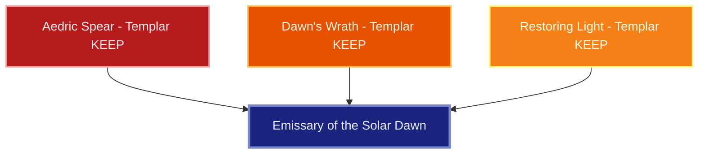
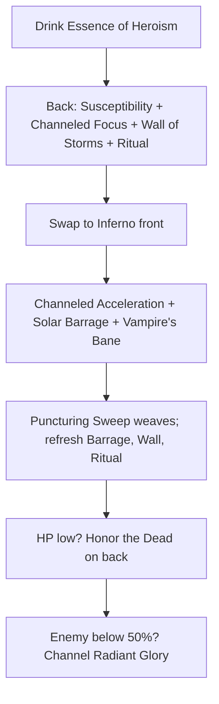
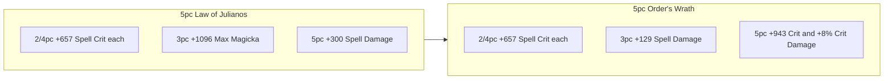

# Build Plan - Pelatiah: Emissary of the Solar Dawn (Peak Magicka Templar)

> **Character profile:** [pelatiah.md](pelatiah.md) — Level 50 Male Imperial Templar, CP 1103, @SOLAEGIS (NA). Pronouns: **he/him**.

Pelatiah is an Imperial diplomat-monk of Cyrodilic lineage who broke from the collapsed Imperial bureaucracy to serve as an **Emissary of Light and Solar Reckoning** under the Ebonheart Pact. This plan is **peak Templar**: class identity first, not Uber subclassing. He keeps all three native lines — **Aedric Spear**, **Dawn's Wrath**, and **Restoring Light** — and fights as a Magicka solo overland judge: **Puncturing Sweep** jabs, **Radiant Glory** execute, **Ritual of Retribution** cleanse, **Channeled Focus** rune.

Live Pelatiah is already on that Trinity (no subclass) at **CP 1103** with 64 Magicka. The old write-up dropped Spear for Psijic and put Destruction skills on a Restoration bar; that is not this kit. Guild **Psijic** stays only as a slotted tool (**Channeled Acceleration** for Major Force). Gear is 100% craftable (**Law of Julianos** + **Order's Wrath**) via account artisan **@masisi**.

---

## Build at a glance

| **Attribute** | **Recommendation** |
| :--- | :--- |
| **Gender / Pronouns** | **Male** (from profile) — **he/him** |
| **Alignment** | **Lawful Good** — Solar Dawn emissary — divine light and Imperial magistrate oath |
| **Primary Stat** | 64 points in **Magicka** — **live:** 64 Magicka (26,840 Health · 23,468 Magicka · 17,023 Stamina · 2,735 Spell Power) · **target:** 64 Magicka |
| **Mundus Stone** | **The Shadow** (+11% Critical Damage; +17% with 7× Divines) — **live:** The Shadow (equipped) |
| **Vampirism** | **Never** — solar judgment never took the blood; profile is Never, not Cured |
| **Lycanthropy** | **Never** — mutually exclusive with active vampirism; he has neither |
| **Trinity** | **Aedric Spear** + **Dawn's Wrath** + **Restoring Light** KEEP — **live:** all three native · **decision:** peak Templar is jabs + beam + rune; no foreign line beats those pillars on craftable solo gear |
| **Sets** | **5 Law of Julianos + 5 Order's Wrath** (100% craftable, 5-1-1) — **live:** Trainee 5/5 + Meridia's Blessed 5/5 + Julianos 1/5 + Withered Hand 1/5 · **target:** Julianos body + Inferno, Order's Wrath head/shoulders/jewelry + Lightning |
| **Bars** | Front: Inferno Staff ("The Solar Spear") · Back: Lightning Staff ("The Sacred Rune") |
| **Food** | **Solitude Salmon-Millet Soup** — magicka skills, Health 26,840 is enough for overland, Mag recovery 794 plus Channeled Focus so skip recovery food · **Bewitched Sugar Skulls** if world-boss dodge (cost 4,273 vs 17,023 Stam) fails |
| **Potion** | **Essence of Heroism** (U51: Major Brutality + Major Savagery) |
| **Weapon Poisons** | None (use staff glyphs) |
| **Staff/Weapon Enchant** | Front: **Flame Damage** (Fiery Weapon); Back: **Crusher** (Infused) |
| **Companion** | **Primary (now):** **Bastian Hallix** (Tank/Support) at live CP **1103** + companion **18/20** · **Secondary:** **Isobel Veloise** (Holy Knight) · **Goal (20/20 @ CP160):** **Bastian Hallix** (Tank/Support) |
| **Primary Mount** | **Imperial Horse** (owned) · **Ideal:** **Grand Imperial Warhorse** — see [Collectibles](#collectibles) |
| **Flavor Pet** | **Bravil Retriever** (owned) · **Ideal:** **Imperial War Mastiff** — see [Collectibles](#collectibles) |
| **Costume** | **Imperial Chancellor** (owned-pool) · **Alt:** **Lion Guard Knight** — see [Collectibles](#collectibles) |

**Read next:** [Roleplay](#roleplay-emissary-of-the-solar-dawn) · [Trinity configuration](#trinity-configuration) · [Combat kit](#combat-kit-the-solar-spear-cycle) · [Gear and crafting](#gear-and-crafting-regalia-of-the-solar-magistrate) · [Champion points](#champion-point-mapping-cp-1103) · [Companion](#companion-strategy-the-imperial-vanguard) · [Collectibles](#collectibles) · [Checklist](#next-steps--in-game-action-checklist)

---

## Roleplay: Emissary of the Solar Dawn

When Cyrodiil fell into chaos and imperial legitimacy crumbled, Pelatiah refused to bow to warlords or Daedric usurpers. Carrying the title **Emissary**, he traveled east and offered his oath to the Ebonheart Pact not out of fashion, but because Tamriel still needed an arbiter of divine light.

He is an Imperial magistrate who carries **both spear and sun**. He approaches combat with courtly discipline: he plants the sacred rune, then closes with **Puncturing Sweep** — the Aedric spear made Magicka — and finishes the condemned with **Radiant Glory**. He does not hide the spear behind a staff-only fantasy. The beam is the verdict; the jabs are the writ served in person.

Guild study of the Psijic Order taught him to **accelerate** a fight (Major Force), not to forget the spear. He remains a Templar first.

> [!TIP]
> **Suggested Custom Title:** `Emissary of the Solar Dawn`

> [!NOTE]
> **Build Notes (paste into LAM Custom Title / Build Notes):**
> Pelatiah — Emissary of the Solar Dawn. Imperial Pact magistrate who serves writ and sun: he jabs, he burns, he judges. KEEP Aedric Spear, Dawn's Wrath, and Restoring Light — no subclass. Inferno front ("The Solar Spear"): Vampire's Bane, Solar Barrage, Puncturing Sweep, Channeled Acceleration, Radiant Glory, Crescent Sweep. Lightning back ("The Sacred Rune"): Elemental Susceptibility, Channeled Focus, Unstable Wall of Storms, Ritual of Retribution, Honor the Dead, Solar Prison. 64 Magicka. Mundus: The Shadow. Never vampire, never wolf. Gear: 5 Law of Julianos + 5 Order's Wrath (5-1-1) via @masisi. Companion: Bastian Hallix tank. Mount Imperial Horse. Pet Bravil Retriever. Costume Imperial Chancellor.

> [!TIP]
> **Flavor Pet:** **Bravil Retriever** from the account owned pool (Imperial court dog; Imperial War Mastiff is not in the NA export). **Ideal (any source):** **Imperial War Mastiff**. See [Collectibles](#collectibles).

> [!TIP]
> **Costume:** **Imperial Chancellor** — magistrate silhouette, solar court. **Alt:** **Lion Guard Knight**. Full picks under [Collectibles](#collectibles).

---

## Trinity configuration

### Subclassing decision (required)

Subclass unlocks at **Level 50** via Bahtra at-Hunding (**"A Study in Discipline"**). Unlocking the quest makes subclassing *available* — it does **not** mean he must swap lines. **Default = class-identity-first.** See [docs/subclassing.md](../../../docs/subclassing.md).

**This build's decision:** **KEEP all three native Templar lines.** **Aedric Spear** is the peak-Templar weapon (Puncturing Sweep + Crescent Sweep). **Dawn's Wrath** is the solar verdict (Vampire's Bane, Solar Barrage, Radiant Glory, Solar Prison). **Restoring Light** is the magistrate's engine (Channeled Focus, Ritual of Retribution, Honor the Dead). No foreign line clearly beats those pillars on this solo overland kit with craftable gear. Guild **Psijic** (Channeled Acceleration) is a slotted skill, not a subclass.

| **Pillar** | **Line** | **Origin** | **Slot action** | **Function** |
| :--- | :--- | :--- | :--- | :--- |
| **Weapon** | **Aedric Spear** | Templar (native) | **KEEP** | Magicka spammable (**Puncturing Sweep**) and cheap frontal ult (**Crescent Sweep**). Peak Templar without jabs is not peak Templar. |
| **Verdict** | **Dawn's Wrath** | Templar (native) | **KEEP** | Ranged DoT (**Vampire's Bane**), AoE pulse (**Solar Barrage**), execute beam (**Radiant Glory**), Major Maim ult (**Solar Prison**) |
| **Engine** | **Restoring Light** | Templar (native) | **KEEP** | Major Resolve + Magicka recovery (**Channeled Focus**), ground DoT/cleanse (**Ritual of Retribution**), emergency heal (**Honor the Dead**) |

> [!IMPORTANT]
> **Do not subclass by default.** Only replace a native line later if a foreign line clearly outperforms it on the same content with craftable gear already correct. Live export is already KEEP-all — leave it that way.

---

## Combat kit: The Solar Spear Cycle

Open on the Lightning back bar with Major Breach, the rune, wall, and ritual. Swap to the Inferno front bar, lock Major Force, jab with **Puncturing Sweep**, and channel **Radiant Glory** when the target drops under 50%. Dest/Dest keeps Wall and Elemental Susceptibility legal; Restoring Light skills work on dest bars.

### Skill bars

Document **slotted morph names as shown in the skills UI** (not unmorphed base or wiki-only labels). Each morph appears at most once across bars. Bars match equipped weapon types (Inferno front, Lightning back).

#### Front Bar (Inferno Destruction Staff): "The Solar Spear"

| **Slot** | **Class/Line** | **Base → Morph** | **Role** | **Profile** |
| :--- | :--- | :--- | :--- | :--- |
| **1** | Dawn's Wrath (Templar) | Sun Fire → **Vampire's Bane** | Ranged Flame DoT + **Major Prophecy** | Live |
| **2** | Dawn's Wrath (Templar) | Solar Flare → **Solar Barrage** | AoE holy fire pulse | Respec (replaces **Inner Light** — duplicate Major Prophecy) |
| **3** | Aedric Spear (Templar) | Puncturing Strikes → **Puncturing Sweep** | Magicka spammable + self-heal | Live (move to this slot) |
| **4** | Psijic Order (Guild) | Accelerate → **Channeled Acceleration** | **Major Force** (+20% Crit Damage) — guild skill, not a subclass | Respec (live is unmorphed **Accelerate**) |
| **5** | Dawn's Wrath (Templar) | Radiant Destruction → **Radiant Glory** | Execute beam; heals for a large share of damage dealt | Live |
| **6 (Ult)** | Aedric Spear (Templar) | Radial Sweep → **Crescent Sweep** | Low-cost frontal AoE ultimate | Live |

#### Back Bar (Lightning Destruction Staff): "The Sacred Rune"

| **Slot** | **Class/Line** | **Base → Morph** | **Role** | **Profile** |
| :--- | :--- | :--- | :--- | :--- |
| **1** | Destruction Staff | Weakness to Elements → **Elemental Susceptibility** | Status effects + **Major Breach** (−5,948 Resistance) | Live |
| **2** | Restoring Light (Templar) | Rune Focus → **Channeled Focus** | **Major Resolve** (+5,948 Armor) + Magicka recovery | Live |
| **3** | Destruction Staff | Wall of Elements → **Unstable Wall of Storms** | Lightning ground DoT + explosion — **must** match the Lightning staff | Respec (live Wall of Storms is on an Inferno backup) |
| **4** | Restoring Light (Templar) | Cleansing Ritual → **Ritual of Retribution** | Templar ground DoT + cleanse | Respec (replaces **Blazing Spear**) |
| **5** | Restoring Light (Templar) | Rushed Ceremony → **Honor the Dead** | Emergency burst heal + Magicka refund on low HP | Respec (replaces **Consuming Trap**) |
| **6 (Ult)** | Dawn's Wrath (Templar) | Solar Disturbance → **Solar Prison** | **Major Maim** (−15% enemy damage) + AoE explosion | Respec (live repeats **Crescent Sweep**) |

Live kit bugs called in the Profile column: drop **Inner Light** (Vampire's Bane already owns Major Prophecy); morph **Accelerate**; drop Soul Magic **Consuming Trap**; split ultimates; put **Unstable Wall of Storms** on the Lightning bar, not the Inferno.

### Rotation and combat tips

#### Solo combat tips

1. **Rune first.** Cast **Channeled Focus** before hard pulls. Standing in the rune is Major Resolve and the Magicka engine for jabs and the beam.
2. **Execute.** Below 50% Health, **Radiant Glory** is the verdict. The morph heals him from the damage he deals — stay in the channel unless the ground is lethal.
3. **Staff swap is loadout, not flavor.** Live Lightning-front / Inferno-back inverts Ancient Knowledge and leaves Wall of Storms on the wrong bar. Inferno front for the beam and jabs; Lightning back for the wall.
4. **Do not slot Crushing Shock.** The spammable is **Puncturing Sweep**. Dest filler is the wall and Susceptibility.

### Passive skills

Pelatiah has **67 Skill Points available**. All three Templar lines and both dest/resto weapon lines are already maxed live. Spend on morphs first, then leftover guild/armor.

#### Templar — Aedric Spear (KEEP)

* **Piercing Spear** (II), **Spear Wall** (II), **Burning Light** (II), **Balanced Warrior** (II) — live maxed. Crit damage, block, wrap damage, Weapon/Spell Damage. Do not drop this line.

#### Templar — Dawn's Wrath (KEEP)

* **Enduring Rays** (II), **Prism** (II), **Illuminate** (II), **Restoring Spirit** (II) — live maxed.

#### Templar — Restoring Light (KEEP)

* **Mending** (II), **Sacred Ground** (II), **Light Weaver** (II), **Master Ritualist** (II) — live maxed. Sacred Ground keys off the Channeled Focus rune.

#### Weapon — Destruction Staff

* **Tri Focus** (II), **Penetrating Magic** (II), **Elemental Force** (II), **Ancient Knowledge** (II), **Destruction Expert** (II) — live maxed. Inferno front favors single-target / beam; Lightning back favors the wall.

#### Weapon — Restoration Staff

* Line is maxed live. This kit does **not** equip a Restoration staff (dest skills would be illegal on that bar). Leave resto passives; do not plan Combat Prayer.

#### Guild — Psijic Order (slotted tool, not subclass)

* **See the Unseen** — live. Unlock **Clairvoyance**, **Spell Orb**, **Concentrated Barrier**, **Deliberation** while **Channeled Acceleration** stays slotted.

#### Guild — Fighters Guild

* **Intimidating Presence**, **Slayer** (III), **Banish the Wicked** (III), **Skilled Tracker** (III) — live maxed. No Fighters ability is slotted; do not chase Dawnbreaker over Crescent Sweep / Solar Prison.

#### Armor / Race

* **Light Armor** and **Heavy Armor** lines maxed live. Keep **Concentration** (Light) and **Undaunted Mettle** if the 5-1-1 weights are on.
* **Imperial:** **Tough**, **Imperial Mettle**, **Red Diamond** — live maxed (skill-cost reduction and Health/Stamina).

#### Morph spend (first 67 points)

1. **Channeled Acceleration** (from live Accelerate).
2. **Solar Barrage**, **Ritual of Retribution**, **Honor the Dead**, **Solar Prison** if not already morphed.
3. Remaining: Psijic passives, then flex.

---

## Gear and crafting: Regalia of the Solar Magistrate

Built 100% on **craftable** sets. **5 Law of Julianos** + **5 Order's Wrath** is the Magicka crit package: flat Spell Damage plus crit chance and **+8% Critical Damage**. Values below are CP160 gold from `query_sets.py` / `llm_digest.jsonl`.

Live Training / Meridia pieces are placeholders. Do not gold-glyph them.

### Set rationale

| **Set** | **5-Piece Bonus** | **Role in the Build** |
| :--- | :--- | :--- |
| **Law of Julianos** | +300 Weapon and Spell Damage (2/4pc +657 crit; 3pc +1,096 Magicka) | Always-on Spell Damage floor for jabs and the beam |
| **Order's Wrath** | +943 Critical Chance and **+8% Critical Damage / Critical Healing** (2/4pc +657 crit; 3pc +129 WD/SD) | Multiplies Shadow mundus and Templar crit; +429 Spell Damage with Julianos 5pc (300 + 129) |

> [!NOTE]
> **Why not Night Mother's Gaze?** 5pc Major Breach is worth **0** while **Elemental Susceptibility** is already on the bar.
>
> **Why not New Moon Acolyte?** 5pc is +401 Spell Damage but **+5% ability cost** and a 9-trait gate — worse for a jab + beam Magicka kit.
>
> **Why not Shattered Fate 5pc?** Pen-only. Major Breach already covers a chunk of the 18,200 resistance cap (cap is general ESO knowledge — re-check after each patch). Crit from Julianos + Order's Wrath is the better crafted pair.

### Target loadout

**5 Light / 1 Medium / 1 Heavy** (Undaunted). The old write-up used two Heavy pieces.

| **Slot** | **Set** | **Weight** | **Trait** | **Enchantment** | **Quality** |
| :--- | :--- | :--- | :--- | :--- | :--- |
| **Head** | Order's Wrath | Heavy | Divines | Max Magicka | Epic / Gold |
| **Shoulders** | Order's Wrath | Medium | Divines | Max Magicka | Epic / Gold |
| **Chest** | Law of Julianos | Light | Divines | Max Magicka | Epic / Gold |
| **Hands** | Law of Julianos | Light | Divines | Max Magicka | Epic / Gold |
| **Waist** | Law of Julianos | Light | Divines | Max Magicka | Epic / Gold |
| **Legs** | Law of Julianos | Light | Divines | Max Magicka | Epic / Gold |
| **Feet** | Law of Julianos | Light | Divines | Max Magicka | Epic / Gold |
| **Neck** | Order's Wrath | Jewelry | Arcane | Spell Damage | Epic / Gold |
| **Ring 1** | Order's Wrath | Jewelry | Arcane | Spell Damage | Epic / Gold |
| **Ring 2** | Order's Wrath | Jewelry | Arcane | Spell Damage | Epic / Gold |
| **Front Weapon** | Law of Julianos (Inferno Staff) | Wood | Precise | Flame Damage | Epic / Gold |
| **Back Weapon** | Order's Wrath (Lightning Staff) | Wood | Infused | Crusher | Epic / Gold |

**Front bar — Inferno Staff:** Precise (+7.2% Weapon/Spell Crit at gold 2H) stacks with Order's Wrath and The Shadow. Flame glyph matches Vampire's Bane / solar kit.

**Back bar — Lightning Staff:** Infused (+30% enchant at gold, half cooldown) on **Crusher** for penetration toward the 18,200 cap after Major Breach. A Weapon Damage glyph is the weaker back-bar pick.

Two-handed staves count as **2** set pieces on the active bar: front is Julianos 7 / Order's Wrath 5; back is Julianos 5 / Order's Wrath 7.

### Crafting handoff (@masisi)

| **Detail** | **Recommendation** |
| :--- | :--- |
| **Style** | Imperial / Order of the Hour |
| **Set station** | Law of Julianos (Wrothgar, Boreal Forge — 6 traits) · Order's Wrath (High Isle, Steadfast Hammer and Saw — 3 traits) |
| **Traits** | Divines (Armor), Arcane (Jewelry), Precise (Inferno), Infused (Lightning) |
| **Interim (pre-target)** | Keep live Trainee / Meridia until CP160 gold lands. **Armor of the Seducer** (3 traits) only if Julianos mats are gated |
| **Quality path** | Purple (Epic) standard → Gold weapons first (Inferno, then Lightning). Do not gold-glyph Training pieces about to be replaced |

> [!NOTE]
> **Research gate:** Coordinate with @masisi before gold-quality CP160 work. See [`masisi.md`](masisi.md) for account crafter status.

---

## Champion Point Mapping (CP 1103)

> [!NOTE]
> **Star catalog:** Exact names, max points, and slottable vs passive from [`champion_points_reference.md`](../../templates/champion_points_reference.md) (YAML: [`champion_points.yaml`](../../templates/champion_points.yaml)). **4** slotted stars per discipline at 900+ total CP. Walk `prerequisites` (ancestor minimums before children). Do not copy the old 742-point / 3-slot map.

Full CP budget: **368 Warfare / 367 Fitness / 368 Craft** (1103 total). Live has 448 unspent — this is the spend target.

**Planning rules:**

- **Per-discipline cap:** 368 / 367 / 368 at CP 1103 (`total ÷ 3`).
- **Slotted stars:** **4** per discipline.
- **Passives:** never consume a slot; spend in catalog stage increments.

### Warfare (Blue — 368 Points)

Ancestor path: **Precision 10** unlocks Fighting Finesse; **Eldritch Insight 10** + **Tireless Discipline 10** + Precision unlock **Piercing**; Piercing 10 unlocks Master-at-Arms, Deadly Aim, and Thaumaturge; Piercing 10 unlocks **Flawless Ritual**; Flawless 10 unlocks **War Mage**.

| **Slotted Star** | **Spend** | **Benefit** |
| :--- | :--- | :--- |
| **Fighting Finesse** | 50 points | +8% Critical Damage and Critical Healing (catalog; not the old +10% line) |
| **Master-at-Arms** | 50 points | Direct-damage increase (jabs, beam ticks that count as direct) |
| **Deadly Aim** | 50 points | Single-target increase (Glory, Vampire's Bane, Sweep) |
| **Thaumaturge** | 50 points | DoT increase (Wall, Ritual, Barrage, Bane) — live already 46/50 on this path |

**Passives (no slot needed — 168 points):**

* **Precision (20/20):** Fighting Finesse ancestor; +320 Critical Chance
* **Eldritch Insight (20/20):** Piercing ancestor; +520 Max Magicka
* **Tireless Discipline (40/40):** Piercing ancestor; +520 Max Stamina (helps the 4,273 dodge)
* **Piercing (20/20):** +700 Offensive Penetration
* **Flawless Ritual (40/40):** Magical status chance (War Mage ancestor)
* **War Mage (28/30):** Magical attack Spell Damage — 28 spends the last 28 of 368 (30 would overshoot)

200 slotted + 20 + 20 + 40 + 20 + 40 + 28 = **368**.

### Fitness (Red — 367 Points)

**Sustained by Suffering** is the fourth slot because live already has it at 50 and this kit stands in a rune while overland DoTs and status effects apply negative effects — the recovery proc matches jab/beam sustain better than a second mitigation slot. **Ironclad** is the swap if he is rarely under a negative effect.

Ancestor path: **Mystic Tenacity 10** unlocks Sustained by Suffering. **Sprinter 10** + **Hero's Vigor 10** unlock **Hasty**; Hasty 10 unlocks **Tireless Guardian**; Tireless 10 unlocks **Fortification**.

| **Slotted Star** | **Spend** | **Benefit** |
| :--- | :--- | :--- |
| **Boundless Vitality** | 50 points | +1,400 Max Health |
| **Fortified** | 50 points | +1,730 Armor |
| **Rejuvenation** | 50 points | +90 Health, Magicka, and Stamina Recovery |
| **Sustained by Suffering** | 50 points | Recovery while under negative effects (live 4th slot) |

**Passives (no slot needed — 166 points; 1 CP unspent):**

* **Tumbling (30/30):** Roll Dodge cost −240
* **Sprinter (20/20):** Sprint cost; Hasty ancestor
* **Hero's Vigor (20/20):** +560 Max Health
* **Mystic Tenacity (20/20):** Sustained ancestor; shorter incoming status
* **Hasty (16/16):** Sprint speed; Tireless ancestor
* **Tireless Guardian (20/20):** Block cost
* **Fortification (20/20):** Bash / block cluster
* **Defiance (20/20):** Break Free cost −220

200 + 166 = **366**. The last Fitness point has no catalog stage that spends exactly 1.

### Craft (Green — 368 Points)

Catalog lists **Rationer as Passive**, not a fourth slot. Fourth **slottable** is **Master Gatherer** (overland diplomat; live already 15). Rationer stays in passives for food duration.

Live already unlocked War Mount / Gifted Rider / Master Gatherer — do not spend 50 on **Fade Away** or 50 on **Meticulous Disassembly** just to satisfy a YAML edge the character already walked past.

| **Slotted Star** | **Spend** | **Benefit** |
| :--- | :--- | :--- |
| **Steed's Blessing** | 48 points | Out-of-combat move speed (1/stage; 48 leaves room for a clean 368) |
| **War Mount** | 75 points | No out-of-combat mount Stamina cost |
| **Gifted Rider** | 50 points | Mount speed |
| **Master Gatherer** | 75 points | Faster node harvest (4th slottable) |

**Passives (no slot needed — 120 points):**

* **Treasure Hunter (50/50):** Chest quality (passive)
* **Rationer (30/30):** +30 minutes food duration
* **Fortune's Favor (10/50):** Wanderer ancestor
* **Wanderer (10/50):** Wayshrine cost; Steadfast ancestor
* **Steadfast Enchantment (10/50):** Enchant charge; Rationer ancestor
* **Plentiful Harvest (10/50):** War Mount ancestor (with Gifted Rider 10)

48 + 75 + 50 + 75 + 50 + 30 + 10 + 10 + 10 + 10 = **368**.

---

## Companion Strategy: The Imperial Vanguard

Companion gear is separate from player gear — companions equip **Companion's** weapons, armor, and jewelry with **companion-only traits** (Quickened, Aggressive, Bolstered). There are no player gear sets or 5-piece bonuses on companions.

> [!NOTE]
> **Live export:** **Bastian Hallix** — Level **18/20**, Companion's Ice Staff and mixed Aggressive/Quickened scraps, **DPS** bar (Fiery Flail / Destructive Blast). Character **Level 50 / CP 1103**. Respec him to tank 1H&S; he is already the primary and the goal.

### Companion picks

| **Tier** | **Companion** | **Role** | **Roleplay fit** | **Mechanical fit (at current stats)** |
| :--- | :--- | :--- | :--- | :--- |
| **Primary (now)** | **Bastian Hallix** | Tank / Support | Imperial battle-mage retinue escorting the Emissary | At 18/20 he can taunt; live ice-staff DPS kit does not. Swap to 1H&S so Pelatiah can channel Radiant Glory |
| **Secondary** | **Isobel Veloise** | Holy Knight Tank | Knight of Stendarr beside the Pact diplomat | World-boss survivability and heals when Bastian is down or rapport-blocked |
| **Goal (20/20 @ CP160)** | **Bastian Hallix** | Frontline Tank | Capped Imperial vanguard | Capped health, permanent taunt, heavy Bolstered |

### Goal companion — Bastian Hallix: Imperial Shield

Bastian is the anvil; Pelatiah is the solar spear.

| **Setting** | **Recommendation** |
| :--- | :--- |
| **Role** | Frontline Tank / Crowds |
| **Gear Weight** | 7/7 Heavy Companion Armor |
| **Gear Trait** | **Bolstered** (+Armor) and **Quickened** (−Cooldowns) |
| **Loadout** | Full Heavy Companion Armor + **Companion's One Hand and Shield** |
| **Acquisition** | White basics from merchant armorers; **Superior+** traited pieces from boss drops while he is active. Not part of the @masisi player craft. |

#### Bastian's support skill bar (goal @ 20/20)

1. **Provoke (1H&S):** Frontline taunt.
2. **Drake's Blood (Dragonknight):** Heavy self-heal and mitigation.
3. **Kindred Grace (Guild):** AoE shield for master and companion.
4. **Crushing Claws (Dragonknight):** AoE immobilize.
5. **Ritual of Salvation (Guild):** Ground damage-reduction rune.
6. *Ultimate:* **Unleashed Rage** — Emergency burst shield and stun.

### Primary now — Bastian Hallix

He is already the pick. Level **18 → 20**, replace the ice staff and DPS morphs, farm **Companion's** Heavy Bolstered / Quickened. Do not put Julianos or Order's Wrath on him.

> [!TIP]
> **Secondary — Isobel Veloise:** Summon her for world bosses if Bastian dies or you want a Stendarr knight in the fiction. Same companion-only heavy + 1H&S rules.

---

## Collectibles

### Mount

Pelatiah rides an Imperial steed appropriate for a Pact magistrate.

> [!NOTE]
> **Owned mounts (account pool / ledger):** Imperial Horse and the Imperial / magistrate set below. Profile Collectibles export is incomplete; do not invent Crown mounts as owned.

#### Primary (owned): Imperial Horse

| **Attribute** | **Detail** |
| :--- | :--- |
| **Why** | Regal Imperial road-horse for an official Pact Emissary |
| **Acquisition** | Owned ✅ |
| **Dye pass** | Imperial Gold armor accents with Crimson saddle trim |

#### Other owned options

| **Mount** | **Owned** | **Why** |
| :--- | :--- | :--- |
| **Dwarven War Horse** | ✅ | Heavier magistrate / escort read |
| **Ebon Dwarven Horse** | ✅ | Dark-metal court variant |
| **Midnight Steed** | ✅ | Night-road courier |
| **Psijic Escort Charger** | ✅ | Guild-study silhouette (not a subclass statement) |

#### Avoid thematically

| **Mount type** | **Reason** |
| :--- | :--- |
| **Daedric / nightmare mounts** | Breaks Lawful Good solar court |
| **Jester / carnival mounts** | No Misrule framing |

> [!TIP]
> **Ideal mount (any source):** **Grand Imperial Warhorse** — armored Imperial heraldry. **Acquisition:** Crown Store / crown crates when offered.

#### Favorites (ESO Favorite Collectibles / Collections)

Imperial Horse, Dwarven War Horse, Ebon Dwarven Horse, Midnight Steed, Psijic Escort Charger — Imperial / magistrate steeds; owned thematic set only; enable random favorite mount when 2+ are favorited.

### Pet

#### Primary (owned): Bravil Retriever

| **Attribute** | **Detail** |
| :--- | :--- |
| **Why** | Imperial court dog from the owned NA pool. **Imperial War Mastiff is not in the export** — do not mark it owned. Bravil Retriever also keeps Golden Eagle as Brontanax's flavor pet. |
| **Acquisition** | Owned ✅ (account pool) |

#### Other owned options

| **Pet** | **Why** |
| :--- | :--- |
| **Golden Eagle** (owned) | Solar herald — favorite it; Brontanax already uses it as flavor pet |
| **Dwarven War Dog** (owned) | Escort / court variant |

> [!TIP]
> **Ideal pet (any source):** **Imperial War Mastiff** — magistrate hound. **Acquisition:** Crown Store / collectible sources when offered.

#### Favorites (ESO Favorite Collectibles / Collections)

Bravil Retriever, Golden Eagle, Dwarven War Dog, Covenant Breton Terrier — Imperial court / solar set; summon a random favorite vanity pet when 2+ are set.

### Costume

Full-body **costumes** (Collections → Appearance → Costumes), not Outfit Station motifs.

#### Primary: Imperial Chancellor

| **Attribute** | **Detail** |
| :--- | :--- |
| **Why** | Magistrate of the Solar Dawn — court plates and Imperial authority |
| **Acquisition** | Owned-pool S-tier on NA (`docs/collectibles_companion_ledger.md`) |
| **Dye notes** | Divine Gold plates, Imperial Crimson cloth, Obsidian leather if the costume dyes |

#### Alt / situational

| **Costume** | **When to wear** |
| :--- | :--- |
| **Lion Guard Knight** | Holy-knight days / Stendarr read beside Isobel |
| **Satakalaaam Imperial Armor** | Field kit when the Chancellor robe is too courtly |
| **None (Outfit Station only)** | When showing 5-1-1 Julianos / Order's Wrath weights |

### Dye and style

**Visual Theme: Magistrate of the Solar Dawn**

| **Slot** | **Style** | **Visual reasoning** |
| :--- | :--- | :--- |
| **Outfit** | Imperial Heavy / Order of the Hour | Elegant Imperial plates with sunburst trim when not in costume |

**Dye palette:** **Divine Gold** (primary plates), **Imperial Crimson** (cloth accents), **Obsidian Black** (leather undertones).

---

## Next Steps & In-Game Action Checklist

Follow this list to lock **The Solar Spear**. Do not gold-glyph Training / Meridia pieces that Phase 2 will replace.

### Phase 0 — Today (functional build)

1. **Attributes:** Confirm 64 points in **Magicka**.
2. **Mundus:** Confirm **The Shadow**.
3. **Trinity:** Leave **Aedric Spear / Dawn's Wrath / Restoring Light**. Do not subclass Psijic over Spear.
4. **Weapons:** Equip **Inferno** on the front bar and **Lightning** on the back bar (swap the live pair).
5. **Action Bars:** Slot [Skill bars](#skill-bars). Morph **Channeled Acceleration**. Drop **Inner Light** and **Consuming Trap**. Split ults (**Crescent Sweep** / **Solar Prison**). Put **Unstable Wall of Storms** on Lightning.
6. **Skill points:** Spend the **67** available points per [Passive skills](#passive-skills).

### Phase 1 — Craft (interim)

7. **[Phase 1]** Wear live Trainee / Meridia until @masisi can craft CP160 gold. Optional **Armor of the Seducer** only if Julianos mats are gated.

### Phase 2 — Craft (target)

8. **[Phase 2]** Commission `@masisi` for 5pc **Law of Julianos** (Light body + Inferno Precise Flame) and 5pc **Order's Wrath** (Heavy head, Medium shoulders, Arcane jewelry, Lightning Infused Crusher) per [Target loadout](#target-loadout).

### Phase 3 — Polish

9. **[Phase 3]** Gold the Inferno first, then the Lightning. Apply Magicka / Spell Damage / Flame / Crusher glyphs on the **new** pieces only.
10. **[Phase 3]** Spend the CP 1103 map per [Champion Point Mapping](#champion-point-mapping-cp-1103) (4 slots; 448 live unspent).
11. **Favorites (ESO Favorite Collectibles):** Collections → set mount/pet favorites per [Collectibles](#collectibles); clear off-theme favorites on this character.

### Finish

12. **Companion:** Level **Bastian Hallix** 18 → 20. Replace ice-staff DPS with Companion's Heavy **1H&S** Bolstered/Quickened. Keep **Isobel** ready as secondary.
13. **Costume:** Equip **Imperial Chancellor** (or Lion Guard Knight in the field).
14. **Regenerate profile:** Run `/cm` in-game and update [pelatiah.md](pelatiah.md) when the build is live.

---

## Appendix: Champion Point star catalog

All Warfare, Fitness, and Craft stars with constellation, type, and max points:

**[`champion_points_reference.md`](../../templates/champion_points_reference.md)**
